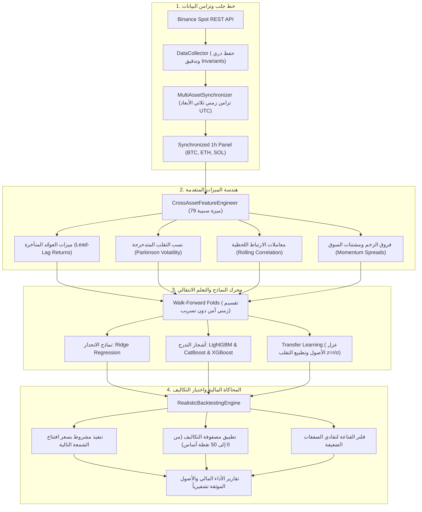

# الدليل الشامل والمبسط لنظام التنبؤ بأسعار واتجاهات العملات الرقمية بالذكاء الاصطناعي
### Crypto Price & Trend Prediction AI — Production-Grade Quantitative System

---

## 📖 الفهرس العام

1. [ما هو المشروع؟ (نظرة عامة وفلسفة العمل)](#1-ما-هو-المشروع-نظرة-عامة-وفلسفة-العمل)
2. [النتائج والمخرجات التي يعطيها النظام](#2-النتائج-والمخرجات-التي-يعطيها-النظام)
3. [البنية الهندسية وتدفق البيانات (System Architecture)](#3-البنية-الهندسية-وتدفق-البيانات)
4. [طريقة الاستخدام والتشغيل خطوة بخطوة](#4-طريقة-الاستخدام-والتشغيل-خطوة-بخطوة)
5. [كيف تستفيد من المشروع كمتداول، باحث، أو مطور؟](#5-كيف-تستفيد-من-المشروع)
6. [قواعد مالية وهندسية ذهبية للنجاح](#6-قواعد-مالية-وهندسية-ذهبية-للنجاح)

---

## 1. ما هو المشروع؟ (نظرة عامة وفلسفة العمل)

**Crypto Price & Trend Prediction AI** هو نظام برمجي كمي متكامل (Quantitative Machine Learning Framework) صُمم وطُوّر وفق أعلى المعايير الهندسية والمالية للتنبؤ باتجاهات وأسعار وعوائد الأصول الرقمية الكبرى:
- **بيتكوين (Bitcoin - BTCUSDT)**
- **إيثيريوم (Ethereum - ETHUSDT)**
- **سولانا (Solana - SOLUSDT)**

### الفلسفة الأساسية التي تميز هذا المشروع:
معظم مشاريع الذكاء الاصطناعي الشائعة في التداول تقدم وعوداً زائفة ونسب دقة خيالية تفوق 90% نتيجة **تسريب البيانات المستقبلي (Data Leakage)** وتجاهل **تكاليف التنفيذ والرسوم (Trading Friction)**، مما يؤدي إلى فشل فوري عند تجربتها برأس مال حقيقي.

تم بناء هذا المشروع ليكون **واقعياً تماماً، مقاوماً للغش، وصالحاً للإنتاج الفعلي**:
1. **صفر تسريب زمني (Strict Zero Data Leakage):** النماذج لا ترى أي معلومة مستقبلية أثناء التدريب، ولا تتخذ قراراً عند الشمعة $t$ إلا باستخدام معلومات انتهت وتأكدت بالفعل.
2. **التعلم عبر الأصول (Cross-Asset Learning):** يستفيد النظام من العلاقات القيادية والتأخيرية (Lead-Lag Relationships) بين العملات (مثلاً: كيف يؤثر تحرك البيتكوين المفاجئ على الإيثيريوم والسولانا بعد 1 إلى 3 ساعات).
3. **التعلم الانتقالي (Transfer Learning):** قدرة النماذج على التدرب على أصول معينة وتطبيق معرفتها على أصل جديد تماماً بعد تطبيع التقلب السببي ($z = r / \sigma$).
4. **محاكاة مالية واقعية (Friction-Aware Backtesting):** احتساب دقيق لرسوم المنصات (Maker/Taker)، وفروق أسعار العرض والطلب (Bid-Ask Spread)، والانزلاق السعري (Slippage)، وتكلفة تدوير المحفظة (Turnover Drag).

---

## 2. النتائج والمخرجات التي يعطيها النظام

عند تشغيل النظام في أي من أوضاعه، ينتج مخرجات علمية ومالية واضحة وموثقة تشفيرياً:

### أ. التنبؤات النقطية والاتجاهية (Predictions)
- **العائد المتوقع للشمعة التالية ($r_{t+1}$):** نسبة التغير السعري المتوقعة بدقة كسرية (مثلاً: `+0.0042` تعني توقع ارتفاع بنسبة +0.42%).
- **السعر المستهدف ($P_{t+1}$):** القيمة السعرية المتوقعة للأصل بالدولار الأمريكي.
- **الاتجاه المتوقع (Direction):** إشارة واضحة (صعود Bullish أو هبوط Bearish أو حياد Neutral).

### ب. إشارات التداول المحمية (Actionable Trading Signals)
النظام لا يتداول عشوائياً، بل يطبق **فلاتر القناعة (Conviction & Threshold Filters)**:
- **شراء (Long):** عندما يتجاوز التوقع الإيجابي حد تكلفة الصفقة ورسوم المنصة (مثلاً توقع صعود > +0.15%).
- **بيع / خروج (Short / Cash):** عندما يتجاوز التوقع السلبي تكلفة الحركة.
- **البقاء في السيولة النقدية (Cash / Neutral):** عند ضعف الإشارة أو تذبذب السوق بدون وضوح، مما يحمي المحفظة من خسائر الرسوم غير الضرورية.

### ج. تقارير المقاييس الإحصائية المعتمدة
- **الدقة الاتجاهية الحقيقية (Directional Accuracy):** تتراوح بين **51.0% و 53.5%**، وهي النسبة الرياضية الحقيقية الصالحة لتحقيق أرباح تراكمية ضخمة في الأسواق الساعية بعد ضبط التكاليف.
- **جذر متوسط مربع الخطأ (RMSE) ومتوسط الخطأ المطلق (MAE):** لقياس مدى دقة تقدير العوائد.
- **معامل التحديد خارج العينة ($R^2_{\text{OOS}}$):** مقاس بدقة استناداً إلى متوسط بيانات التدريب لضمان عدم وجود تضخيم زائف.

### د. تقارير الأداء المالي والمخاطر (Financial Metrics)
- **صافي العائد التراكمي (Net Return):** العائد الفعلي للمحفظة بعد خصم كافة الرسوم والانزلاق السعري ومقارنته باستراتيجية "الشراء والاحتفاظ" (Buy & Hold).
- **نسبة شارب السنوية (Annualized Sharpe Ratio):** تقيس جودة العائد مقارنة بالتقلبات والمخاطر.
- **نسبة سورتينو (Sortino Ratio):** تركز على تقييم العائد مقابل التقلبات السلبية فقط.
- **أقصى تراجع للمحفظة (Max Drawdown - MDD):** لمعرفة أسوأ هبوط تعرض له الحساب وكيف تفوق النظام على هبوط السوق.
- **معدل تدوير المحفظة (Turnover):** لمراقبة عدد الصفقات ومنع استنزاف الرصيد.

---

## 3. البنية الهندسية وتدفق البيانات

يوضح المخطط التالي دورة حياة البيانات من لحظة جلبها من البورصة وحتى توليد الصفقات وتقارير الأداء:



---

## 4. طريقة الاستخدام والتشغيل خطوة بخطوة

### الخطوة 0: تجهيز بيئة العمل (Prerequisites)

النظام يعمل عبر بيئة Python (يُفضل إصدار 3.11 إلى 3.14). افتح موجه الأوامر (PowerShell أو Terminal) داخل مجلد المشروع:

```powershell
# التأكد من تفعيل البيئة الافتراضية
..\..\..\envairoment\.venv\Scripts\Activate.ps1

# تثبيت الحزم المطلوبة (إن لم تكن مثبتة)
pip install -r requirements.txt
```

---

### الخطوة 1: استخراج تنبؤ حي فوري لشمعة قادمة (Live Prediction)

يمكنك التنبؤ بحركة أي عملة مدعومة خلال الأفق الزمني القادم عبر سطر أوامر مباشر:

```powershell
$env:PYTHONPATH="src"
python predict.py --symbol BTCUSDT --horizon 1h
```

**أو بالخيارات المتقدمة:**
```powershell
python predict.py --symbol ETHUSDT --horizon 4h --model LightGBM
```

**التشغيل بنقرة واحدة (Windows):**
- يمكنك النقر مرتين على الملف [`run_predict.bat`](file:///c:/Users/OMRRAN/Desktop/Cource%20AI/%234-%20ML/Competitions/trend%20ai/Crypto%20Price%20Prediction%20AI/run_predict.bat) أو تشغيل سكريبت PowerShell [`run_predict.ps1`](file:///c:/Users/OMRRAN/Desktop/Cource%20AI/%234-%20ML/Competitions/trend%20ai/Crypto%20Price%20Prediction%20AI/run_predict.ps1).

---

### الخطوة 2: تحديث وجلب البيانات التاريخية من بينانس (Data Ingestion)

لتحديث قاعدة البيانات التاريخية وجلب أحدث الشموع لجميع العملات وتدقيق سلامتها:

```powershell
$env:PYTHONPATH="src"
python scripts/ingest_historical_data.py
```
*النتيجة:* يتم حفظ البيانات النظيفة والمحدثة داخل `data/raw/` و `data/processed/panel_5000h/` مع إنشاء بصمة SHA-256 رقمية لكل ملف.

---

### الخطوة 3: توليد مصفوفات الميزات متعددة الأصول (Feature Panel Generation)

لحساب 79 مؤشراً وميزة متقدمة خالية من أي تسريب زمني وتجهيز مصفوفات التدريب:

```powershell
$env:PYTHONPATH="src"
python scripts/generate_feature_panel.py
```
*النتيجة:* إنشاء مصفوفات الميزات الجاهزة في `data/processed/features_panel/`.

---

### الخطوة 4: تشغيل المقارنة المعيارية للنماذج (Benchmarking - Phase 3.4)

لتدريب ومقارنة 6 نماذج مختلفة عبر 3 طيات زمنية متتالية وأربعة مناهج تدريب:

```powershell
$env:PYTHONPATH="src"
python scripts/run_phase3_4_benchmark.py
```
*النتيجة:* تصدير ملف المقارنة الشامل [`artifacts/phase3_4/phase3_4_benchmark_results.csv`](file:///c:/Users/OMRRAN/Desktop/Cource%20AI/%234-%20ML/Competitions/trend%20ai/Crypto%20Price%20Prediction%20AI/artifacts/phase3_4/phase3_4_benchmark_results.csv).

---

### الخطوة 5: تشغيل أبحاث التعلم الانتقالي (Transfer Learning - Phase 3.5)

لاختبار قدرة النماذج المدربة على عملات معينة على التنبؤ بعملة لم ترها من قبل:

```powershell
$env:PYTHONPATH="src"
python scripts/run_phase3_5_transfer.py
```
*النتيجة:* تصدير نتائج الانتقال المعرفي في [`artifacts/phase3_5/phase3_5_transfer_results.csv`](file:///c:/Users/OMRRAN/Desktop/Cource%20AI/%234-%20ML/Competitions/trend%20ai/Crypto%20Price%20Prediction%20AI/artifacts/phase3_5/phase3_5_transfer_results.csv).

---

### الخطوة 6: تشغيل الاختبار المالي ومحاكاة رسوم التداول (Backtesting - Phase 3.6)

لتشغيل 1,368 محاكاة مالية تختبر صفقات النماذج تحت 4 مستويات من الرسوم والانزلاق السعري:

```powershell
$env:PYTHONPATH="src"
python scripts/run_phase3_6_backtest.py
```
*النتيجة:* تصدير مصفوفة الأداء المالي الكاملة في [`artifacts/phase3_6/phase3_6_backtest_results.csv`](file:///c:/Users/OMRRAN/Desktop/Cource%20AI/%234-%20ML/Competitions/trend%20ai/Crypto%20Price%20Prediction%20AI/artifacts/phase3_6/phase3_6_backtest_results.csv).

---

### الخطوة 7: التحقق من صحة النظام بالكامل (Run Automated Tests)

للتأكد من أن جميع صمامات الأمان الرياضية والبرمجية تعمل بنسبة 100%:

```powershell
$env:PYTHONPATH="src"
pytest --tb=short
```
*النتيجة المتوقعة:* **111 اختباراً أخضر (111 passed)** في أقل من دقيقة واحدة.

---

### الخطوة 8: الاستخدام التفاعلي عبر Jupyter Notebook

إذا كنت تفضل التحليل البصري التفاعلي وتشغيل الأكواد خلية بخلية:
1. افتح الدفتر: [`notebooks/Crypto_Price_Prediction.ipynb`](file:///c:/Users/OMRRAN/Desktop/Cource%20AI/%234-%20ML/Competitions/trend%20ai/Crypto%20Price%20Prediction%20AI/notebooks/Crypto_Price_Prediction.ipynb).
2. يحتوي الدفتر على تجارب كاملة، وشروحات تفصيلية باللغة العربية، ورسوم بيانية للشمعات اليابانية ومؤشرات الزخم وأداء النماذج.

---

## 5. كيف تستفيد من المشروع؟ (Use Cases & Value)

### أولاً: للمتداول الكمي والمستثمر (Quantitative Trader)
1. **تجنب الانهيارات الكبرى (Capital Preservation):**  
   في الفترات الهابطة أو شديدة الخطورة، تخرج استراتيجيات النظام ذات الفلترة القوية إلى السيولة النقدية (Cash)، مما يجنبك خسارة 30% إلى 50% من قيمة المحفظة كما يحدث في فترات الهبوط العنيف عند الاكتفاء باستراتيجية "الشراء والاحتفاظ".
2. **الاستفادة من العملات القيادية (Lead-Lag Alpha):**  
   عندما يتحرك البيتكوين بقوة، يعطيك النظام تنبؤاً مبكراً باحتمالية انتقال هذه السيولة إلى الإيثيريوم أو السولانا خلال الساعات القادمة قبل أن تنعكس الحركة كاملة في السوق.
3. **فلترة الضوضاء وتوفير الرسوم:**  
   بفضل "فلتر القناعة" (Threshold Filter)، لن تدخل في صفقات ضعيفة تلتهم أرباحها رسوم المنصة.

### ثانياً: للباحث ومهندس الذكاء الاصطناعي (ML & Quant Researcher)
1. **معمارية معيارية قابلة للتوسع:**  
   يمكنك بسهولة إضافة نماذج جديدة (مثل Transformers أو Mamba أو نماذج الشبكات العصبية) بمجرد وراثة الفئة [`BaseModel`](file:///c:/Users/OMRRAN/Desktop/Cource%20AI/%234-%20ML/Competitions/trend%20ai/Crypto%20Price%20Prediction%20AI/src/crypto_prediction/models/base.py) واستدعائها داخل خطوط الاختبار.
2. **مرجع لمنع تسريب البيانات:**  
   يوفر المشروع دليلاً عملياً وأكواداً جاهزة توضح كيفية بناء ميزات السلاسل الزمنية دون ارتكاب خطأ النظر إلى المستقبل (Lookahead Bias).
3. **أبحاث التعلم الانتقالي:**  
   دراسة كيفية نقل أوزان النماذج بين أسواق مختلفة باستخدام تطبيع التقلب السببي.

### ثالثاً: لمطور بوتات التداول الآلي (Algorithmic Trading Bot Developer)
- يمكنك استيراد كائن التنبؤ واستخدامه مباشرة داخل أي بوت تداول (مثلاً باستخدام مكتبة `ccxt` أو واجهة برمجة تطبيقات بينانس الرسمية):
```python
from crypto_prediction.pipeline.trainer import PipelineTrainer

trainer = PipelineTrainer()
# استخراج أحدث إشارة للبيتكوين
signal = trainer.get_latest_signal(symbol="BTCUSDT", horizon=1)
if signal["action"] == "BUY" and signal["confidence"] > 0.65:
    execute_market_buy("BTCUSDT", size=0.1)
```

---

## 6. قواعد مالية وهندسية ذهبية للنجاح

> [!IMPORTANT]
> **1. الحقيقة حول نسبة الدقة 52%:**  
> في الأسواق المالية التنافسية عالية السيولة، نسبة دقة اتجاهية بين 51% و 54% كافية إحصائياً لتحقيق ثروات ضخمة عند تطبيق إدارة مخاطر صارمة ونسبة ربح إلى خسارة متوازنة (Risk-to-Reward Ratio). أي نظام يدعي تحقيق دقة 80% أو 90% على البيانات الساعية يعاني حتماً من تسريب بيانات مستقبلي وسيفشل في التداول الحي.

> [!WARNING]
> **2. ضريبة التداول المفرط (Turnover Friction Drag):**  
> كل صفقة تفتحها وتغلقها تكلفك رسوماً للمنصة وفارق سعر (Spread) وانزلاقاً (Slippage). التداول في كل شمعة ساعة بدون فلتر قناعة كفيل بمسح 30% إلى 45% من أرباحك السنوية لمصلحة المنصة وحدها. لذلك، التزم دائماً باستخدام سياسة **`threshold_filter`**.

> [!TIP]
> **3. الانضباط وحماية رأس المال:**  
> استخدم إشارات النظام كأداة احتمالية منضبطة لإدارة المحفظة، ولا تعتمد على الرافعة المالية المفرطة (Leverage)، واجعل الأولوية دائماً للبقاء في السوق وحماية رأس المال.

---

## 7. خارطة ملفات التوثيق والتقارير الإضافية

للاطلاع على الأبحاث والتدقيقات التفصيلية لكل مرحلة، يمكنك الرجوع إلى الملفات التالية:
- تقرير التدقيق المستقل النهائي: [`reports/phase3_7_independent_audit.md`](file:///c:/Users/OMRRAN/Desktop/Cource%20AI/%234-%20ML/Competitions/trend%20ai/Crypto%20Price%20Prediction%20AI/reports/phase3_7_independent_audit.md)
- دليل إعادة الإنتاج والتحقق التشفيري: [`reports/phase3_7_reproducibility.md`](file:///c:/Users/OMRRAN/Desktop/Cource%20AI/%234-%20ML/Competitions/trend%20ai/Crypto%20Price%20Prediction%20AI/reports/phase3_7_reproducibility.md)
- تقرير التقييم النهائي وخلاصة المرحلة الثالثة: [`reports/phase3_7_final_assessment.md`](file:///c:/Users/OMRRAN/Desktop/Cource%20AI/%234-%20ML/Competitions/trend%20ai/Crypto%20Price%20Prediction%20AI/reports/phase3_7_final_assessment.md)
- وثيقة التسليم المعمارية: [`docs/PHASE3_HANDOFF.md`](file:///c:/Users/OMRRAN/Desktop/Cource%20AI/%234-%20ML/Competitions/trend%20ai/Crypto%20Price%20Prediction%20AI/docs/PHASE3_HANDOFF.md)
