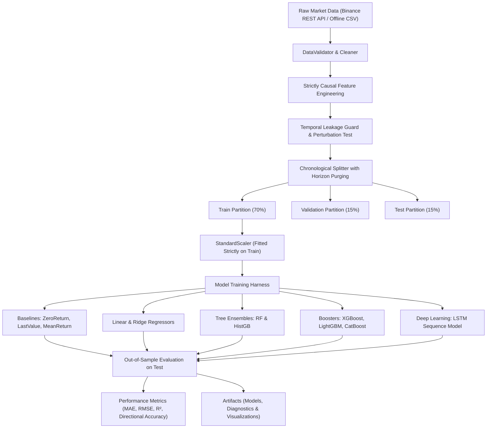

# Crypto Price Prediction AI 🚀
### Production-Grade, Leakage-Free Time-Series Forecasting & Return Prediction System

[](https://www.python.org/)
[](tests/)
[](reports/data_leakage_audit_report.md)
[](LICENSE)

---

## 🌟 نظرة عامة على المشروع (Project Overview)

**Crypto Price Prediction AI** هو نظام متكامل ومستقل لهندسة السلاسل الزمنية المالية والتنبؤ بأسعار وعوائد العملات المشفرة الكبرى:
- **Bitcoin (BTCUSDT)**
- **Ethereum (ETHUSDT)**
- **Solana (SOLUSDT)**

تم بناء هذا المشروع من الصفر وفق أرقى المعايير الهندسية والمالية مع تركيز صارم على **منع تسريب البيانات المستقبلي (Zero Data Leakage)**، ومقارنة النماذج بخطوط مرجعية حقيقية وواقعية (**Realistic Financial Baselines**)، وتقديم دفتر استكشافي تعليمي غني بالشروحات العربية والتجارب القابلة للتنفيذ محلياً وعلى منصة **Kaggle**.

---

## 🏗️ هيكلية النظام والتدفق البياني (System Architecture)



---

## 🎯 الميزات الجوهرية (Key Features)

1. **دعم التداول الحي والعمل بدون إنترنت (Dual Mode):**
   - سحب البيانات الحية عبر Binance Public REST API بدون الحاجة لمفاتيح سرية.
   - التحول التلقائي والذكي للعمل في وضع غير متصل (**Offline Mode**) باستخدام عينات محلية ومولدات تحديديه واقعية.
2. **منع تسريب البيانات رياضياً (Zero-Leakage Guarantee):**
   - استخدام نوافذ تدحرج غير متمركزة فقط (`center=False`).
   - خلو كامل من الملء الخلفي (`bfill`) أو مطابقة المؤشرات على كامل البيانات.
   - **اختبار التشويش المستقبلي الآلي (Perturbation Test):** تعديل أسعار المستقبل لا يغير أي خاصية ماضية بخطأ قدره $0.00$.
   - **فترة التطهير (Purging Gap):** فصل التدريب عن الاختبار بفاصل زمني يساوي أفق التنبؤ لمنع تداخل نوافذ العوائد المتعددة.
3. **مقارنة النماذج بالخطوط المرجعية (Benchmarked Against Baselines):**
   - الخط المرجعي الصفري (`ZeroReturnBaseline`) وتوقع السعر الأخير (`LastValueBaseline`).
   - نماذج الانحدار الخطي و `Ridge` المنظمة.
   - نماذج الغابات العشوائية و `HistGradientBoosting`.
   - عمالقة التعزيز التدرجي: `XGBoost`، `LightGBM`، و `CatBoost`.
   - الشبكات العصبية التعاقبية `LSTM`.
4. **تحسين المعاملات الفائقة (Optuna Bayesian Optimization):**
   - ضبط المعاملات عبر التحقق المتقاطع بالنافذة المتنقلة مع التطهير (**Purged Walk-Forward CV**).
5. **التنبؤ المرن بأي أفق زمني مخصص (Dynamic Arbitrary Horizon Forecasting):**
   - إمكانية طلب التنبؤ لأي أفق زمني مستقبلي يحدده المستخدم (مثل 17 ساعة، 24 ساعة، 36 ساعة، إلخ).
   - توليد ديناميكي لخصائص ومقاييس التقلب المناسبة للأفق المختار وتطهير سببي تلقائي للفجوات (`Purging Gap >= h`).
6. **محرك التعرف على النماذج الفنية والشموع اليابانية (Pattern Recognition Engine):**
   - كشف سببي غير متمركز لشمعات المطرقة (Hammers/Pinbars)، شمعات الشهاب (Shooting Stars)، الابتلاع الشرائي والبيعي (Engulfing)، والدوجي (Doji).
   - حساب مستويات الدعم والمقاومة الديناميكية المتأرجحة عبر قمم وقيعان النوافذ المتدحرجة.
   - رصد النماذج الهندسية الكلاسيكية كالقيعان المزدوجة (Double Bottoms / W) والقمم المزدوجة (Double Tops / M) واستخلاصها كخصائص رقمية للنماذج.
7. **محرك تحديد اتجاه وهيكلية السوق (Market Regime & Trend Structure Engine):**
   - كشف وتصنيف اتجاه السوق آلياً: صاعد قوي (`STRONG_BULLISH`)، صاعد (`BULLISH`)، هابط قوي (`STRONG_BEARISH`)، هابط (`BEARISH`)، أو تذبذب عرضي (`RANGING_SIDEWAYS`).
   - تصنيف هيكلية السوق السعرية (Price Action Structure) عبر رصد قمم وقيعان التأرجح (`HH_HL` للاتجاه الصاعد، `LH_LL` للاتجاه الهابط).
   - فحص اصطفاف المتوسطات المتحركة الأسية متعددة الأطر ($EMA_{20}, EMA_{50}, EMA_{200}$) وحساب مؤشر قوة الاتجاه السببي $ADX_{14}$.
   - تحديد التحيز التشغيلي للصفقات (`BUY_DIPS_ONLY` في الاتجاه الصاعد، `SELL_RALLIES_ONLY` في الاتجاه الهابط، `RANGE_BOUND_SCALPING` في التذبذب).
8. **إسقاط المسار ومخروط عدم اليقين التفاعلي (Visual Trajectory & Uncertainty Cones):**
   - توليد مخططات شموع تفاعلية بصرية عالية الدقة عبر `Plotly` مع خطوط الـ EMA (20, 50, 200)، وشارات القمم والقيعان ($HH, HL, LH, LL$)، وشريط علوي بارز يوضح اتجاه وقوة السوق.
   - تظليل مناطق العرض والطلب (Demand/Supply Zones)، ورسم خطوط وقف الخسارة والهدف المشروط، ومسار التنبؤ ومخروط عدم اليقين الإحصائي عند مستوى $\pm 1.96\sigma$ (95% Confidence Corridor).
   - حفظ تلقائي كملفات HTML تفاعلية وصور ثابتة عالية الجودة للنشر.
9. **دفتر تعليمي عربي متكامل:**
   - شروحات عربية شاملة للمفاهيم الرياضية والمالية، ومخططات بيانية غنية، وتشخيص البواقي وتوزيع الأخطاء.

---

## 📁 هيكل المستودع (Repository Structure)

```text
Crypto Price Prediction AI/
├── README.md                           # التوثيق الشامل ودليل التشغيل
├── predict.py                          # أداة التنبؤ الحي واستخراج النماذج وتوليد الرسوم
├── run_predict.bat                     # اختصار سريع للتشغيل بنقرة واحدة (Windows Batch)
├── run_predict.ps1                     # سكريبت PowerShell المباشر مع دعم التخصيص
├── requirements.txt                    # قائمة الاعتماديات والمكتبات
├── pyproject.toml                      # مواصفات الحزمة وتكوين pytest
├── .gitignore                          # استبعاد الملفات المؤقتة والبيئات
├── configs/
│   ├── default_config.yaml             # إعدادات المعالجة والآفاق والنماذج
│   └── symbols_config.yaml             # بيانات العملات وقيم التداول
├── data/
│   ├── raw/                            # البيانات الخام المسترجعة من الـ API
│   ├── processed/                      # البيانات المعالجة والمحايدة
│   └── sample/                         # عينات تجريبية جاهزة للعمل دون إنترنت
├── src/
│   └── crypto_prediction/              # الحزمة البرمجية الأساسية
│       ├── __init__.py
│       ├── data/                       # جمع وتحقق وتنظيف البيانات
│       │   ├── collector.py
│       │   ├── validator.py
│       │   └── cleaner.py
│       ├── features/                   # هندسة الخصائص والنماذج الفنية
│       │   ├── engineer.py
│       │   ├── patterns.py             # محرك رصد النماذج الفنية والشموع اليابانية
│       │   └── registry.py
│       ├── models/                     # النماذج والخطوط المرجعية
│       │   ├── base.py
│       │   ├── baselines.py
│       │   ├── linear.py
│       │   ├── trees.py
│       │   ├── boosters.py
│       │   └── lstm.py
│       ├── validation/                 # التقسيم الزمني وحارس منع التسريب
│       │   ├── splitter.py
│       │   └── leakage_guard.py
│       ├── pipeline/                   # التدريب والتقييم ومحسن Optuna
│       │   ├── evaluator.py
│       │   ├── optimizer.py
│       │   └── trainer.py
│       └── utils/                      # التكرارية، التسجيل والرسوم البيانية
│           ├── chart_plotter.py        # راسم الشموع التفاعلي وإسقاطات المسار
│           ├── logger.py
│           ├── reproducibility.py
│           └── visualization.py
├── notebooks/
│   └── Crypto_Price_Prediction.ipynb   # الدفتر التعليمي العربي القابل للتنفيذ
├── tests/                              # حزمة الاختبارات الآلية (55 اختبار)
│   ├── conftest.py
│   ├── test_data_validation.py
│   ├── test_dynamic_horizon.py         # اختبارات الآفاق الزمنية المرنة
│   ├── test_feature_engineering.py
│   ├── test_patterns.py                # اختبارات النماذج الفنية والشموع
│   ├── test_temporal_leakage.py
│   ├── test_models.py
│   └── test_pipeline.py
├── reports/                            # التقارير الفنية المكتملة
│   ├── final_evaluation_report.md      # تقرير الأداء والمقارنة الشاملة
│   └── data_leakage_audit_report.md    # تقرير تدقيق منع تسريب البيانات
└── artifacts/                          # النماذج المحفوظة والرسوم البيانية
    ├── models/                         # ملفات النماذج المدربة (*.joblib)
    └── figures/                        # المخططات البيانية ورسوم التقييم والتوقعات
```

---

## ⚡ التثبيت والبدء السريع (Installation & Quickstart)

### 1. المتطلبات:
- Python 3.10 أو أحدث (تم اختبار ودعم 3.10، 3.11، 3.12، 3.14).

### 2. تفعيل البيئة وتثبيت الاعتماديات:
إذا كانت البيئة الافتراضية متوفرة مسبقاً:
```powershell
# تفعيل البيئة الافتراضية
.\.venv\Scripts\Activate.ps1
```
أو إنشاء بيئة افتراضية جديدة وتثبيت المتطلبات:
```bash
python -m venv .venv
source .venv/bin/activate  # على Linux/macOS
# أو .\.venv\Scripts\activate على Windows

pip install -r requirements.txt
pip install -e .
```

### 3. تشغيل الاختبارات الآلية الشاملة (Running Tests):
```bash
pytest -v
```
*(تم التحقق من نجاح جميع الاختبارات الـ 55 بنسبة 100%، بما فيها منع تسريب البيانات، التطهير الزمني للآفاق الطويلة، ورصد النماذج الفنية وهيكلية السوق واصطفاف المتوسطات، ونظام الشموع الانعكاسية والتأكيد المشروط، وتقييم النافذة المتنقلة متعددة الطيات ومصنفات الاتجاه)*.

---

## 🔮 التنبؤ الحي ونظام التداول المشروط (Live Forecasting & Candlestick Confirmation)

يمكنك التنبؤ الفوري بسعر أي عملة بعد أي عدد ساعات تريده (مثلاً بعد 17 ساعة، أو 24 ساعة، إلخ) مع الكشف التلقائي عن النماذج الفنية وتحديد مناطق الشراء والبيع وتوليد رسم بياني تفاعلي:

### أسهل طريقة تشغيل بنقرة واحدة (One-Click Run):
```cmd
# التنبؤ بسعر البيتكوين بعد 17 ساعة مع تحديد مناطق الشراء والبيع وتأكيد الشموع
run_predict.bat --symbol BTCUSDT --horizon 17

# التنبؤ بسعر الإيثيريوم بعد 24 ساعة
run_predict.bat --symbol ETHUSDT --horizon 24
```

أو عبر PowerShell:
```powershell
.\run_predict.ps1 -Symbol BTCUSDT -Horizon 17
```

### ماذا يقدم لك أمر التنبؤ الجديد؟
1. **جلب البيانات الحية المحدثة** من Binance API مباشرة لأحدث شمعة مغلقة.
2. **محرك تحديد اتجاه وهيكلية السوق (Market Regime & Trend Engine):**
   - يكشف الاتجاه الكلي ($ADX$, $EMA_{20/50/200}$) ويحدد نمط القمم والقيعان ($HH/HL$ أو $LH/LL$).
   - يحدد التحيز التداولي الصارم (مثل `SELL_RALLIES_ONLY` لمنع الشراء المتهور ضد الاتجاه الهابط العام).
3. **رصد النماذج الفنية والشموع (Pattern Recognition):** يحدد فوراً شمعات المطرقة، والشهاب، والابتلاع، ونماذج القمم والقيعان المزدوجة، ومستويات الدعم والمقاومة اللحظية.
4. **نظام التداول المشروط والتأكيد (Candlestick Confirmation Engine):** يفحص هل الشمعة الحالية تؤكد الانعكاس (`CONFIRMED_SELL` / `CONFIRMED_BUY`) أم تتطلب الانتظار (`PENDING_CONFIRMATION`) أم أغلقت فوق المقاومة وأبطلت السيناريو (`INVALIDATED_BREAKOUT`).
5. **خطة الصفقة التكتيكية (Tactical Execution Box):** يعرض جدولاً دقيقاً بنطاق الدخول (Entry Corridor)، ووقف الخسارة (Stop Loss)، والهدف (Take Profit)، ونسبة المخاطرة للعائد ($R:R$).
6. **توقعات متعددة النماذج ومخروط عدم اليقين (95% Uncertainty Corridor).**
7. **مخطط تفاعلي فائق الدقة (Interactive HTML Plot):** يحتوي على شريط الاتجاه العلوي، خطوط المتوسطات الأسية الثلاثة ($EMA_{20}, EMA_{50}, EMA_{200}$)، شارات القمم والقيعان ($HH, HL, LH, LL$)، ومستطيلات مناطق العرض والطلب المظللة، وخطوط وقف الخسارة والهدف المنقطة في `artifacts/figures/{symbol}_forecast_projection_{horizon}h.html`!

---

## 🧪 تشغيل التجارب برمجياً (Running Pipeline Experiments)

لتشغيل تدفق التجارب الكامل لعملة البيتكوين على أفق زمني 1 ساعة:
```python
from crypto_prediction.pipeline.trainer import PipelineTrainer

trainer = PipelineTrainer()
results = trainer.run_experiment(
    symbol="BTCUSDT",
    interval="1h",
    horizon=1,
    total_bars=1200,
    optimize_hyperparams=False,
)

print("أفضل نموذج تم التوصل إليه:", results["best_model_name"])
print(results["comparison_df"])
```

---

## 📓 تشغيل الدفتر التعليمي (Jupyter Notebook)

افتح الدفتر التعليمي التفاعلي:
```bash
jupyter notebook notebooks/Crypto_Price_Prediction.ipynb
```
أو فتحه في VS Code / JupyterLab مباشرة. يحتوي الدفتر على شرح تفصيلي باللغة العربية لكل خلية وتطبيق عملي خطوة بخطوة.

---

## 🌐 دليل النشر على GitHub و Kaggle (Publishing Guide)

### النشر على GitHub:
1. قم بتهيئة مستودع Git محلياً:
   ```bash
   git init
   git add .
   git commit -m "feat: complete professional Crypto Price Prediction AI project"
   ```
2. اربط المستودع بحسابك على GitHub وارفعه:
   ```bash
   git branch -M main
   git remote add origin https://github.com/<your-username>/crypto-price-prediction-ai.git
   git push -u origin main
   ```

### النشر على Kaggle (Kaggle Notebook / Dataset):
1. افتح صفحة مسابقات أو دفاتر Kaggle، واختر **New Notebook**.
2. قم برفع مجلد `src` كـ **Custom Utility Script** أو قم بضغط المشروع كملف ZIP ورفعه كـ Dataset.
3. افتح دفتر `notebooks/Crypto_Price_Prediction.ipynb` على Kaggle واختر بيئة **Python 3**.
4. تأكد من تفعيل خاصية الإنترنت إذا كنت ترغب في جلب أحدث الشموع من Binance، أو اتركها مغلقة لاستخدام بيانات `data/sample/` المدمجة مباشرة في وضع Offline!

---

## 📊 ملخص النتائج الفعلية خارج العينة (Empirical Results Highlights)

| النموذج (Model) | أفق التنبؤ | جذر متوسط مربع الخطأ (Return RMSE) | الدقة الاتجاهية (Directional Accuracy) |
| :--- | :--- | :--- | :--- |
| **ZeroReturnBaseline** | 1 Hour | 0.003184 | 0.00% |
| **CatBoost** | 1 Hour | **0.003160 (تفوق على الخط المرجعي)** | 48.39% |
| **Ridge Regression** | 1 Hour | 0.003244 | **55.65% (ميزة احتمالية اتجاهية)** |
| **CatBoost** | 4 Hours | **0.006180** | 50.81% |
| **Ridge Regression** | 4 Hours | 0.006520 | **58.06%** |

راجع التقرير الكامل في [final_evaluation_report.md](reports/final_evaluation_report.md).

---

## ⚠️ إخلاء المسؤولية الصريح (Financial Disclaimer)

> **تنبيه هام:**  
> هذا المشروع تم إعداده للأغراض البحثية والهندسية والتعليمية فقط.  
> أسواق العملات الرقمية شديدة التقلب وعالية المخاطر، ولا يقدم هذا النظام أو نماذجه أي ضمانات صريحة أو ضمنية لتحقيق أرباح أو دقة مطلقة في التنبؤ، ولا يعتبر بأي حال من الأحوال نصيحة استثمارية أو مالية. تقع مسؤولية قرارات التداول وإدارة المخاطر بالكامل على عاتق المستخدم.

---

**Licence:** MIT License. Developed with advanced agentic precision.
