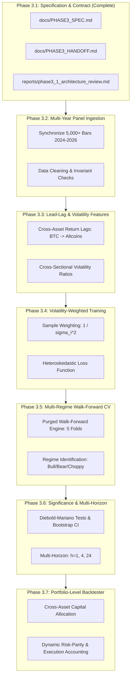

# Phase 3 Technical Specification: Multi-Year Panel Scaling & Cross-Asset Lead-Lag Architecture

**Document ID:** `docs/PHASE3_SPEC.md`  
**Author:** Senior Software Architect, Quantitative ML Engineer, and Time-Series Research Lead  
**Date:** 2026-10-27  
**Status:** Approved & Frozen Baseline  
**Base Commit / Tree State:** `ea1cd0871f64c741f291af82f192811c7237a9f5`  
**Reference Deliverables:**  
- `reports/phase1_remediation.md`  
- `reports/phase2_results.md`  
- `reports/phase2_1_validation_audit.md`  

---

## 1. Executive Summary & Scope

Phase 2 established that multi-asset training and zero-shot transfer (Leave-One-Asset-Out) provide genuine predictive improvements for Bitcoin over single-asset models and the Zero-Return baseline ($R^2_{\text{OOS}} = +0.0136$, $\text{DA} = 54.8\%$). However, Phase 2 also identified critical limitations:
1. **Short Evaluation Window:** 199 hourly bars ($\sim 8.3$ days) is statistically insufficient to test across varied macroeconomic market regimes (bull, bear, high volatility, low liquidity).
2. **Negative Transfer on High-Beta Altcoins:** Solana (SOLUSDT) resisted general transfer from BTC/ETH due to volatility asymmetry ($\sigma_{\text{SOL}} \approx 1.30\%$ vs $\sigma_{\text{BTC}} \approx 0.83\%$).
3. **Absence of Concurrent Lead-Lag Signals:** Models were trained on pooled individual rows without using Bitcoin's concurrent or lagged momentum to predict altcoin movements.

**Phase 3 Objective:** Scale the multi-asset research platform to a multi-year panel (2024–2026), introduce cross-asset lead-lag feature engineering and volatility-conditioned loss weighting, implement rolling walk-forward cross-validation across distinct market regimes, and construct a portfolio-level allocation backtester.

---

## 2. Freeze of Phase 2 Baseline

To prevent data snooping or hindsight bias, the Phase 2 baseline is strictly frozen as follows:

### 2.1 Benchmark Dataset Freeze
- **Assets:** BTCUSDT, ETHUSDT, SOLUSDT
- **Interval:** 1-Hour (`1h`)
- **Raw Observations:** 1,500 bars per asset (`2024-01-01 00:00:00` to `2024-03-03 11:00:00 UTC`)
- **Usable Observations:** 1,331 bars per asset (168 warmup lookback + 1 target shift dropped)
- **Partitions:**
  - **Train Split (70%):** 931 bars (`2024-01-08 00:00` to `2024-02-15 18:00 UTC`)
  - **Purge Gap 1:** 1 bar (`2024-02-15 19:00 UTC`)
  - **Validation Split (15%):** 199 bars (`2024-02-15 20:00` to `2024-02-24 02:00 UTC`)
  - **Purge Gap 2:** 1 bar (`2024-02-24 03:00 UTC`)
  - **Test Split (15%):** 199 bars (`2024-02-24 04:00` to `2024-03-03 10:00 UTC`)

### 2.2 Frozen Baseline Performance (Test Partition)
All future Phase 3 models must compare against these frozen Phase 2 benchmark numbers:

| Asset | Model / Strategy | Test RMSE | Out-of-Sample $R^2$ | Directional Accuracy | Time-Series Rank IC |
| :--- | :--- | :---: | :---: | :---: | :---: |
| **BTCUSDT** | ZeroReturnBaseline | 0.008930 | +0.000446 | *NaN* | 0.0000 |
| **BTCUSDT** | Single-Asset CatBoost | 0.008992 | -0.013567 | 50.3% | +0.0214 |
| **BTCUSDT** | Pooled XGBoost | 0.008888 | +0.008988 | 53.8% | +0.1032 |
| **BTCUSDT** | LOAO RandomForest | **0.008868** | **+0.013641** | 51.8% | +0.1021 |
| **BTCUSDT** | LOAO CatBoost | 0.008869 | +0.013409 | **54.8%** | +0.0894 |
| **ETHUSDT** | ZeroReturnBaseline | **0.010216** | +0.000169 | *NaN* | 0.0000 |
| **ETHUSDT** | Single-Asset CatBoost | 0.010338 | -0.023753 | 50.8% | +0.0118 |
| **ETHUSDT** | Pooled CatBoost | 0.010284 | -0.013674 | **53.8%** | +0.0451 |
| **ETHUSDT** | LOAO CatBoost | 0.010277 | -0.012305 | 52.3% | +0.0382 |
| **SOLUSDT** | ZeroReturnBaseline | **0.012822** | +0.002241 | *NaN* | 0.0000 |
| **SOLUSDT** | Single-Asset CatBoost | 0.013194 | -0.056442 | 47.7% | -0.0152 |
| **SOLUSDT** | Pooled CatBoost | 0.013037 | -0.033621 | 45.7% | +0.0210 |
| **SOLUSDT** | LOAO CatBoost | 0.013309 | -0.077427 | 49.2% | +0.0184 |

---

## 3. Experimental Contract

Every Phase 3 experiment must adhere to this invariant specification:

### 3.1 Target Formulation & Forecast Horizons
The primary target remains the close-to-close forward return over horizon $h \in \{1, 4, 24\}$:
$$r_{i, t+h} = \frac{C_{i, t+h} - C_{i, t}}{C_{i, t}}$$
- Primary Horizon: $h = 1$ hour.
- Multi-Horizon Extensions: $h = 4$ hours, $h = 24$ hours.
- When evaluating multi-step returns ($h > 1$), independent non-overlapping subsampling of length $h$ must be enforced in backtesting.

### 3.2 Information Availability & Causal Timestamping
- Candle $t$ spans $(t_{\text{open}}, t_{\text{close}}]$. At $t_{\text{close}}$, the bar is sealed.
- Feature extraction $X_{i, t}$ uses strictly data available at or before $t_{\text{close}}$.
- Predictions $\hat{r}_{i, t+h}$ are generated at $t_{\text{close}}$.
- Order execution takes place at the open of bar $t+1$ ($O_{i, t+1}$).
- Transaction friction is charged per order side:
  $$\text{fee\_rate} = 0.0010 \quad (0.10\%), \quad \text{slippage\_rate} = 0.0005 \quad (0.05\%)$$
  $$\text{unit\_cost} = 0.0015 \quad (0.15\% \text{ per side})$$

### 3.3 Purging & Embargo Mandate
Between any training partition ending at $t_{\text{train\_end}}$ and evaluation partition beginning at $t_{\text{eval\_start}}$:
$$\Delta t_{\text{gap}} \ge h \text{ bars}$$
This guarantees that forward target labels $r_{i, t+h}$ from the training set do not share overlapping return periods with the evaluation set.

### 3.4 Preprocessing Isolation
All scalers (`StandardScaler`, `RobustScaler`), target transformers, and feature selectors must be fitted **strictly on the training fold**. Fitting scalers across full panels or across validation/test folds is strictly prohibited.

### 3.5 Holdout Isolation
The final 15% chronological test partition is quarantined. No model hyperparameters, feature subsets, or decision thresholds may be tuned against the final test set. All tuning must occur inside the training and validation partitions or via rolling walk-forward cross-validation.

### 3.6 Artifact and Metric Versioning
Every artifact must follow the documented naming convention:
$$\texttt{artifacts/phase3/models/\{symbol\}\_\{interval\}\_\{scope\}\_\{model\}\_h\{h\}\_v\{version\}.joblib}$$
Accompanying each `.joblib` model, a sidecar `_meta.json` must record git commit, training range, feature names, hyperparameters, and scaler parameters.

---

## 4. Phase 3 Subphase Breakdown (3.2 – 3.7)

---

### Subphase 3.2: Multi-Year Panel Ingestion & Temporal Synchronization
- **Objective:** Ingest, validate, clean, and synchronize a multi-year panel (minimum 5,000 continuous hourly bars across BTC, ETH, and SOL spanning 2024–2026).
- **Inputs:** Binance REST API historical downloads / existing local stores.
- **Outputs:** Synchronized clean datasets in `data/processed/panel_5000h/` with identical `DatetimeIndex`.
- **Dependencies:** `DataCollector`, `DataValidator`, `DataCleaner`.
- **Tests:**
  - Verify zero temporal gaps $> 1\text{h}$.
  - Verify OHLCV invariants ($H \ge \max(O,C), L \le \min(O,C), V \ge 0$).
  - Assert exact timestamp alignment across all symbols.
- **Acceptance Criteria:** Minimum 5,000 synchronized hourly candles for BTC, ETH, and SOL with 0 duplicate candles and 0 missing timestamps.

---

### Subphase 3.3: Cross-Asset Lead-Lag & Volatility Conditioning Feature Engineering
- **Objective:** Augment the feature matrix with cross-asset lead-lag relationships and relative volatility conditioning to resolve Solana's negative transfer.
- **Inputs:** Aligned multi-asset OHLCV panel from 3.2.
- **Outputs:** Enhanced `CrossAssetFeatureEngineer` producing:
  - `btc_return_lag_{1,2,3}`: Bitcoin's prior return as an explicit input for altcoins.
  - `cross_vol_ratio`: $\sigma_{\text{asset}} / \sigma_{\text{BTC}}$ over 24h and 168h windows.
  - `cross_momentum_spread`: Realized return of asset minus Bitcoin return.
- **Dependencies:** `FeatureEngineer`, `src/crypto_prediction/features/`.
- **Tests:**
  - Strict causality test: perturbing future Bitcoin prices does not change altcoin features at $t \le t_{\text{eval}}$.
  - Dimension and scale-invariance verification.
- **Acceptance Criteria:** LeakageGuard audit passes 100%; feature registry documents all cross-asset features.

---

### Subphase 3.4: Volatility-Weighted Loss Functions & Sample Weighting
- **Objective:** Implement sample weighting in pooled gradient boosters to prevent high-beta assets (SOL) from dominating loss gradients and distorting low-beta forecasts (BTC).
- **Inputs:** Cross-asset features and realized return variances.
- **Outputs:**
  - Sample weight formulation: $w_{i, t} = \frac{1}{\sigma_i^2 \sum_j (1 / \sigma_j^2)}$.
  - Integration with XGBoost (`sample_weight`), LightGBM, and CatBoost.
- **Dependencies:** `src/crypto_prediction/models/boosters.py`.
- **Tests:**
  - Verify that weighted booster predictions on synthetic homoskedastic data equal unweighted predictions.
  - Verify that high-variance assets receive inversely proportional sample weights.
- **Acceptance Criteria:** Weighted pooled booster reduces SOL RMSE without degrading BTC RMSE compared to Phase 2 baseline.

---

### Subphase 3.5: Multi-Regime Walk-Forward Cross-Validation Engine
- **Objective:** Replace static single-split validation with a multi-fold purged walk-forward cross-validation engine spanning multiple market regimes.
- **Inputs:** 5,000-bar panel from 3.2.
- **Outputs:**
  - `MultiAssetWalkForwardValidator` executing 5 rolling chronological folds:
    - Fold window: 1,000 bars train, 250 bars val, 250 bars test, 24-bar purge gap.
  - Per-fold and macro-regime performance breakdown (Bull, Bear, Consolidation).
- **Dependencies:** `validation/splitter.py`, `validation/walk_forward.py`.
- **Tests:**
  - Assert strictly disjoint, chronologically ordered folds with guaranteed purge gaps.
  - Assert zero lookahead across all 5 folds.
- **Acceptance Criteria:** Generates complete walk-forward reports across 5 consecutive historical periods with automated regime tagging.

---

### Subphase 3.6: Multi-Horizon Forecasting & Statistical Significance Testing
- **Objective:** Evaluate multi-asset advantage across horizons $h \in \{1, 4, 24\}$ and compute formal statistical significance tests.
- **Inputs:** Multi-horizon targets from `FeatureEngineer`.
- **Outputs:**
  - Diebold-Mariano test statistics and p-values comparing Pooled/LOAO vs. Single-Asset models.
  - Block bootstrap confidence intervals for Sharpe ratio and Directional Accuracy.
- **Dependencies:** `scipy.stats`, `evaluator.py`.
- **Tests:**
  - Verify Diebold-Mariano implementation on synthetic identical vs. superior forecasts.
  - Verify multi-step subsampling prevents serial correlation distortion.
- **Acceptance Criteria:** Formal p-values established; hypothesis $H_1$ confirmed or refuted with statistical rigor ($p < 0.05$).

---

### Subphase 3.7: Portfolio-Level Backtesting & Cross-Asset Allocation Simulation
- **Objective:** Simulate a realistic multi-asset portfolio with capital allocation, risk parity sizing, and transaction friction.
- **Inputs:** Concurrent model predictions for BTC, ETH, and SOL at each timestamp $t$.
- **Outputs:**
  - `PortfolioBacktester` implementing:
    - Rank-based long/cash capital allocation.
    - Volatility-inversed position sizing (risk parity).
    - Maximum gross exposure constraint ($100\%$ capital, spot only).
    - Separate accounting for portfolio turnover, rebalancing drag, and net CAGR.
- **Dependencies:** `pipeline/backtester.py`.
- **Tests:**
  - Conservation of capital test: cash + asset holdings = portfolio net asset value.
  - Order turnover test: rebalancing between assets incurs friction on both legs.
- **Acceptance Criteria:** Minimum 100 completed trades across multi-year timeline with `statistically_reliable = True`.

---

## 5. Architectural Boundaries & Component Reuse Matrix

| Existing Component | Phase 3 Role | Modification Plan |
| :--- | :--- | :--- |
| `DataCollector` | Primary ingestion engine | Reuse without breaking changes; add multi-chunk pagination for 5,000 bars |
| `DataValidator` | OHLCV & gap verification | Reuse as-is; enforce 0 gaps in panel |
| `DataCleaner` | Outlier and duplicate removal | Reuse as-is |
| `FeatureEngineer` | Base feature calculation | Subclass or extend with `CrossAssetFeatureEngineer` |
| `LeakageGuard` | Temporal leakage auditor | Reuse as mandatory pre-flight audit for every fold |
| `ChronologicalSplitter` | Time-series partitioner | Reuse as building block for `MultiAssetWalkForwardValidator` |
| `BaseModel` & Boosters | Model family implementations | Add `sample_weight` parameter to `fit()` in `boosters.py` |
| `StrategyBacktester` | Single-asset trading simulator | Retain as control; construct `PortfolioBacktester` alongside it |
| `ModelEvaluator` | Metrics and benchmarks | Extend with Diebold-Mariano and Cross-Sectional Rank IC |
