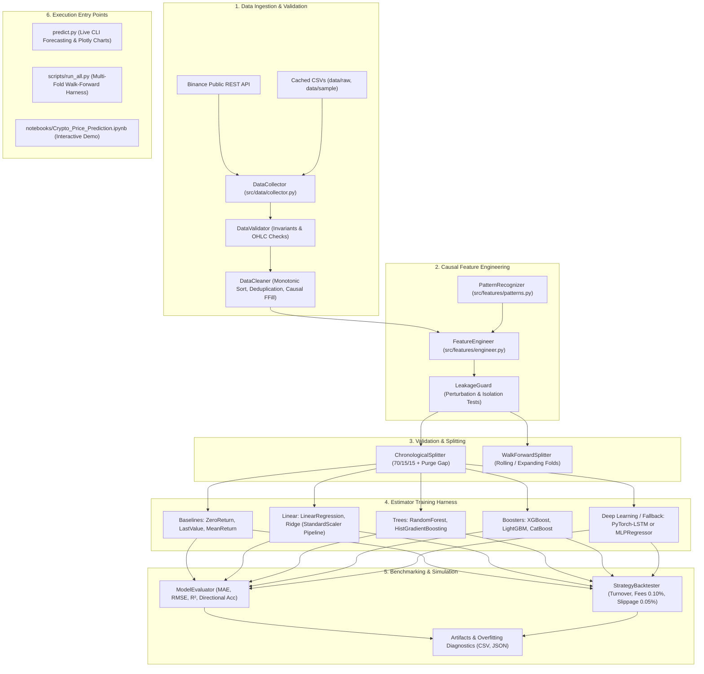
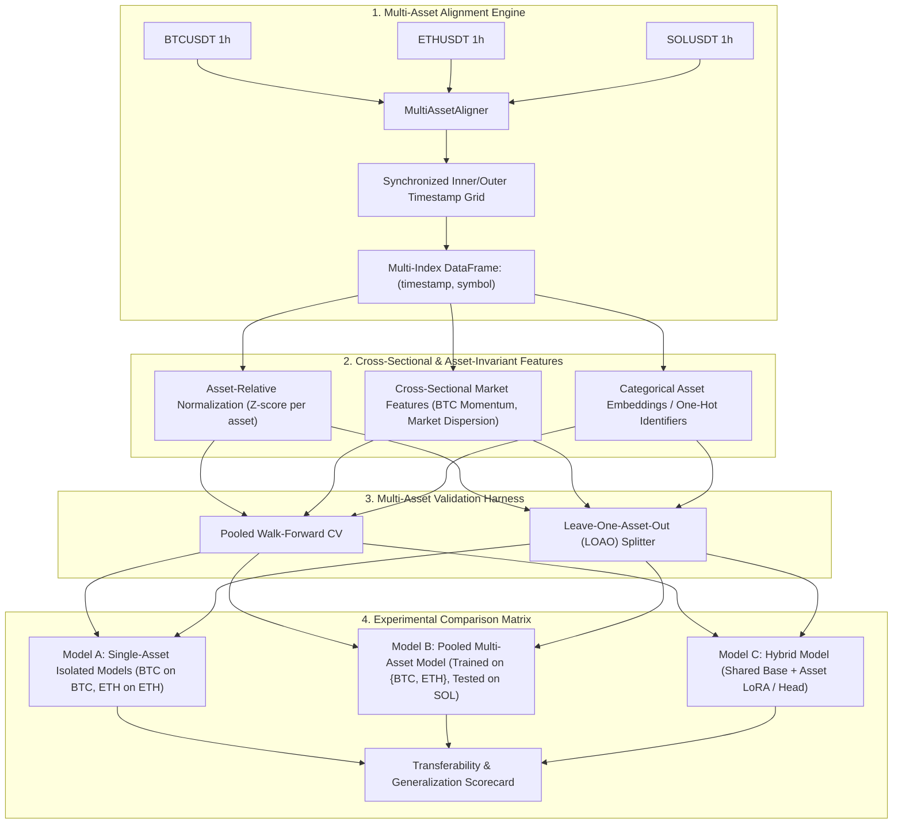
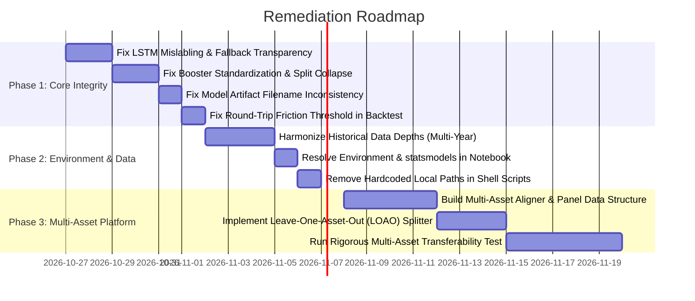

# Comprehensive Engineering & Quantitative Audit Report
# Crypto Price and Trend Prediction AI Platform

**Document Version:** 1.0.0  
**Audit Date:** October 26, 2026  
**Auditing Entity:** Senior AI & Quantitative Engineering Team  
- *Senior Machine Learning Engineer*  
- *Quantitative Research Engineer*  
- *Time-Series Data Engineer*  
- *Software Architect*  
- *Test and Validation Engineer*  

**Repository Audited:** [Crypto Price Prediction AI](https://github.com/EmranYaseen-ALSabry/crypto-price-and-trend-prediction-ai)  
**Execution Environment:** Windows 11 / Python 3.14.5  
**Audit Scope:** Codebase inventory, data pipeline & causality integrity, model implementations, evaluation methodologies, strategy simulation/backtesting, software architecture, and multi-asset transferability readiness.

---

## 1. Executive Summary

This audit conducted an exhaustive, multi-disciplinary inspection of the **Crypto Price and Trend Prediction AI** research platform. The primary research hypothesis of this platform is to investigate whether a model trained across multiple cryptocurrencies (e.g., BTC, ETH, SOL) can learn transferable temporal patterns and generalize to unseen assets superior to independently trained single-asset models.

### Key Audit Conclusions:
1. **Methodological Rigor in Single-Asset Causality (Strength):**  
   The platform's data cleaning, rolling window operations, and chronological splitting with purging gaps demonstrate strict adherence to causal financial engineering. The automated future perturbation test was executed and verified zero look-ahead leakage ($\Delta_{\max} < 10^{-10}$). All 55 automated tests passed in 61.60 seconds.
2. **Nominal LSTM Silently Runs as MLP (Critical Defect):**  
   Due to PyTorch being uninstalled in the active Python 3.14 environment, `LSTMModel` silently defaults to `sklearn.neural_network.MLPRegressor`. Saved model artifacts (such as `artifacts/models/ETHUSDT_LSTM_h1.joblib`) were confirmed via deserialization to contain an `MLPRegressor` despite being named and serialized as `LSTM`.
3. **Gradient Booster Collapse to Baseline Mean (Critical Defect):**  
   Both `XGBoostModel` and `LightGBMModel` apply target standardization `(y - y_mean) / y_std` on return targets. In noisy 1-hour return regimes with default tree regularization, the boosters prune all splits to zero. The inverse transform outputs `0 * y_std + y_mean = y_mean`, resulting in identical predictions, RMSE (0.003142107999), MAE, and directional accuracy as `MeanReturnBaseline` across all test observations.
4. **Negative Out-of-Sample $R^2$ and Zero Backtest Profitability (Confirmed Finding):**  
   Every machine learning model evaluated on the out-of-sample test split registered negative $R^2$ scores (from $-0.012$ to $-0.201$). In simulated trading net of standard exchange fees (0.10%) and execution slippage (0.05%), no model achieved profitability; cautious models took 0 trades, while active models generated negative net returns with Sharpe ratios between $-4.39$ and $-10.17$.
5. **Architectural Gap for Multi-Asset Transferability (Architectural Limitation):**  
   The current system is strictly built around single-symbol pipelines. Feature engineering, dataset preparation, splitters, models, and evaluators expect a 1D time-series index without multi-asset alignment, panel representation, cross-sectional features (e.g., market returns, coin beta), or cross-asset generalization protocols (e.g., Leave-One-Asset-Out CV).
6. **Data Asymmetry Across Assets (High Risk):**  
   In `data/raw/`, `BTCUSDT_1h.csv` contains only 399 bars (16 days), `SOLUSDT_1h.csv` contains 1,000 bars (41 days), while `ETHUSDT_1h.csv` contains 49,999 bars (~5.7 years). Cross-asset training is impossible without aligned historical depths.

---

## 2. Existing Architecture Overview



### Verified Entry Points and Commands:
- **Full Test Suite:**  
  `& "..\..\..\envairoment\.venv\Scripts\python.exe" -m pytest --tb=short` (55 tests passed in 61.60s).
- **Live Prediction & Chart Rendering:**  
  `& "..\..\..\envairoment\.venv\Scripts\python.exe" predict.py --symbol BTCUSDT --interval 1h --horizon 1`
- **Multi-Fold Walk-Forward Harness:**  
  `& "..\..\..\envairoment\.venv\Scripts\python.exe" scripts/run_all.py --symbols ETHUSDT --horizons 1 4 --folds 6`
- **Data Ingestion Script:**  
  `& "..\..\..\envairoment\.venv\Scripts\python.exe" scripts/download_history.py --symbols BTCUSDT ETHUSDT SOLUSDT --years 3 --interval 1h`

---

## 3. Verified Strengths

1. **Strict Temporal Causality & Perturbation Invariance:**  
   In [src/crypto_prediction/features/engineer.py](file:///c:/Users/OMRRAN/Desktop/Cource%20AI/%234-%20ML/Competitions/trend%20ai/Crypto%20Price%20Prediction%20AI/src/crypto_prediction/features/engineer.py), all rolling computations explicitly specify `center=False`. Moving averages, RSI, and MACD rely on backward-looking exponential filters (`adjust=False`). [LeakageGuard.run_perturbation_test](file:///c:/Users/OMRRAN/Desktop/Cource%20AI/%234-%20ML/Competitions/trend%20ai/Crypto%20Price%20Prediction%20AI/src/crypto_prediction/validation/leakage_guard.py#L44-L104) systematically verified that applying a $+250\%$ shock to prices after cutoff resulted in zero alteration ($\Delta = 0.00$) to preceding feature vectors.
2. **Purging Gap Enforcement:**  
   Both [ChronologicalSplitter](file:///c:/Users/OMRRAN/Desktop/Cource%20AI/%234-%20ML/Competitions/trend%20ai/Crypto%20Price%20Prediction%20AI/src/crypto_prediction/validation/splitter.py#L26-L109) and [WalkForwardSplitter](file:///c:/Users/OMRRAN/Desktop/Cource%20AI/%234-%20ML/Competitions/trend%20ai/Crypto%20Price%20Prediction%20AI/src/crypto_prediction/validation/splitter.py#L111-L155) enforce a purge interval $\ge horizon$. When predicting $h$-step returns $(C_{t+h} - C_t)/C_t$, this separation strictly prevents target overlap between training observations and out-of-sample evaluation windows.
3. **Realistic Financial Baselines:**  
   The benchmark harness incorporates `ZeroReturnBaseline` and `MeanReturnBaseline`. In financial return forecasting, zero-return is mathematically equivalent to the random walk hypothesis and is a notoriously hard baseline to beat out-of-sample.
4. **Data Provenance & Policy Enforcement:**  
   [DataCollector](file:///c:/Users/OMRRAN/Desktop/Cource%20AI/%234-%20ML/Competitions/trend%20ai/Crypto%20Price%20Prediction%20AI/src/crypto_prediction/data/collector.py) explicitly embeds metadata attributes `data_source` and `is_synthetic` on DataFrames. In [PipelineTrainer](file:///c:/Users/OMRRAN/Desktop/Cource%20AI/%234-%20ML/Competitions/trend%20ai/Crypto%20Price%20Prediction%20AI/src/crypto_prediction/pipeline/trainer.py#L367), synthetic datasets trigger explicit warnings and invalidate market claims.
5. **Direction Classifier Design:**  
   [DirectionClassifier](file:///c:/Users/OMRRAN/Desktop/Cource%20AI/%234-%20ML/Competitions/trend%20ai/Crypto%20Price%20Prediction%20AI/src/crypto_prediction/models/classifiers.py) filters out small returns below transaction friction ($|r| \le 0.0015$) as a neutral band, formulating direction prediction as a realistic, cost-aware classification problem.

---

## 4. Confirmed Defects

### Defect 1: Nominal LSTM Implementation Silently Operates as an MLP
- **Severity:** Critical
- **Affected Files:**  
  [src/crypto_prediction/models/lstm.py](file:///c:/Users/OMRRAN/Desktop/Cource%20AI/%234-%20ML/Competitions/trend%20ai/Crypto%20Price%20Prediction%20AI/src/crypto_prediction/models/lstm.py#L14-L22), [src/crypto_prediction/pipeline/trainer.py](file:///c:/Users/OMRRAN/Desktop/Cource%20AI/%234-%20ML/Competitions/trend%20ai/Crypto%20Price%20Prediction%20AI/src/crypto_prediction/pipeline/trainer.py#L102), `artifacts/models/*_LSTM_*.joblib`
- **Evidence:**  
  Running runtime inspection via deserialization of `artifacts/models/ETHUSDT_LSTM_h1.joblib`:
  ```text
  Model type: <class 'crypto_prediction.models.lstm.LSTMModel'>
  Name: LSTM
  fallback: <class 'sklearn.neural_network._multilayer_perceptron.MLPRegressor'>
```
  In `trainer.py`, the model is registered under key `"LSTM"` and saved as `{symbol}_LSTM_h{horizon}.joblib`. PyTorch is not installed in the workspace environment, so `TORCH_AVAILABLE` is `False`. The model silently trains a 2-layer scikit-learn `MLPRegressor` on flattened 2D tabular features, completely discarding sequential recurrent state processing.
- **Why It Matters:**  
  Reports and filenames claim deep learning sequence modeling (LSTM), but the actual mathematical model is a feedforward MLP. This misrepresents the algorithm and invalidates research conclusions regarding recurrent neural networks.
- **Recommended Fix:**  
  1. Clearly rename fallback outputs in all artifact filenames, comparison tables, and plots as `MLP_Sequence_Fallback`.  
  2. Implement an explicit check: if a deep learning model is requested but PyTorch is absent, log a visible warning and disable deep learning unless explicitly requested.  
  3. Ensure that when PyTorch is available, sequence tensors $(B, T, F)$ are constructed properly without silent substitution.
- **Verification Test:**  
  Unit test asserting that an `LSTMModel` without PyTorch raises an informative error or is explicitly serialized with the string `MLP_Fallback` in its filename and metadata.

---

### Defect 2: Gradient Boosters Collapse to Training Mean Due to Target Standardization
- **Severity:** Critical
- **Affected Files:**  
  [src/crypto_prediction/models/boosters.py](file:///c:/Users/OMRRAN/Desktop/Cource%20AI/%234-%20ML/Competitions/trend%20ai/Crypto%20Price%20Prediction%20AI/src/crypto_prediction/models/boosters.py#L70-L81) (`XGBoostModel` and `LightGBMModel`)
- **Evidence:**  
  Inspection of [artifacts/BTCUSDT_test_metrics_h1.csv](file:///c:/Users/OMRRAN/Desktop/Cource%20AI/%234-%20ML/Competitions/trend%20ai/Crypto%20Price%20Prediction%20AI/artifacts/BTCUSDT_test_metrics_h1.csv):
  | Model Name | MAE | RMSE | $R^2$ | Directional Accuracy |
  | :--- | :---: | :---: | :---: | :---: |
  | **MeanReturnBaseline** | 0.002187294089 | 0.00314210799897 | -0.003021739875 | 51.2195% |
  | **XGBoost** | 0.002187294089 | 0.00314210799940 | -0.003021740153 | 51.2195% |
  | **LightGBM** | 0.002187294089 | 0.00314210799935 | -0.003021740116 | 51.2195% |
  In `boosters.py`:
  ```python
  self.regressor.fit(X, (y_arr - self._y_mean) / self._y_std)
```
  Because cryptocurrency returns at 1-hour scale have low signal-to-noise ratios, the gradient boosting trees find no splits that overcome the default regularizers (`reg_lambda=1.0`, `min_child_weight`). The trees output 0.0 for every leaf. When unscaled:
  $$\hat{y} = 0.0 \times \sigma_y + \mu_y = \mu_y$$
  XGBoost and LightGBM learned nothing beyond the empirical sample mean.
- **Why It Matters:**  
  Documentation and reports list XGBoost and LightGBM as evaluated models, but both algorithms produced constant outputs identical to `MeanReturnBaseline`.
- **Recommended Fix:**  
  1. Detect when a fitted tree produces constant zero predictions and log a diagnostic warning (`TREE_SPLIT_COLLAPSE`).  
  2. Tune hyperparameters (learning rate, min_child_weight, regularization) specifically for high-noise return spaces, or predict directional probabilities using `DirectionClassifier` instead of unconstrained regression.
- **Verification Test:**  
  Unit test asserting that `model.predict(X_test)` on test features has non-zero sample variance (`np.var(preds) > 1e-12`).

---

### Defect 3: Disconnected Model Artifact Naming Between Training and Live Inference
- **Severity:** Medium
- **Affected Files:**  
  [src/crypto_prediction/pipeline/trainer.py](file:///c:/Users/OMRRAN/Desktop/Cource%20AI/%234-%20ML/Competitions/trend%20ai/Crypto%20Price%20Prediction%20AI/src/crypto_prediction/pipeline/trainer.py#L210), [predict.py](file:///c:/Users/OMRRAN/Desktop/Cource%20AI/%234-%20ML/Competitions/trend%20ai/Crypto%20Price%20Prediction%20AI/predict.py#L124)
- **Evidence:**  
  In `trainer.py`:  
  `model.save(self.models_dir / f"{symbol}_{name}_h{horizon}.joblib")`  
  $\to$ Generates `BTCUSDT_CatBoost_h1.joblib` (omits interval).  
  In `predict.py`:  
  `model_file = models_dir / f"{sym}_{interval}_{name}_h{horizon}.joblib"`  
  $\to$ Looks for `BTCUSDT_1h_CatBoost_h1.joblib`.  
  Because the filenames do not match, `predict.py` fails to locate the pre-trained artifact and executes unmonitored on-the-fly training on the full 10,000 bars without validation oversight.
- **Why It Matters:**  
  The models evaluated in official experiment reports are never actually used in live prediction; live predictions use unverified on-the-fly models fitted on the full dataset.
- **Recommended Fix:**  
  Standardize artifact naming across both modules to `{symbol}_{interval}_{name}_h{horizon}.joblib`.
- **Verification Test:**  
  Integration test ensuring that after `trainer.run_experiment(..., interval="1h")`, `predict.py` loads the exact artifact without retraining.

---

### Defect 4: Missing Dependency in Educational Notebook
- **Severity:** Medium
- **Affected Files:**  
  [notebooks/Crypto_Price_Prediction.ipynb](file:///c:/Users/OMRRAN/Desktop/Cource%20AI/%234-%20ML/Competitions/trend%20ai/Crypto%20Price%20Prediction%20AI/notebooks/Crypto_Price_Prediction.ipynb) (Cell 8), `requirements.txt`, `pyproject.toml`
- **Evidence:**  
  Cell 8 executes:  
  `from statsmodels.tsa.stattools import adfuller`  
  However, `statsmodels` is not listed in `requirements.txt` or `pyproject.toml`, and is not installed in the virtual environment. Executing the notebook from start to finish causes an immediate `ModuleNotFoundError`.
- **Why It Matters:**  
  The educational showcase cannot be executed cleanly by external reviewers or students without unguided troubleshooting.
- **Recommended Fix:**  
  Either add `statsmodels>=0.14.0` to `pyproject.toml` and `requirements.txt`, or implement a lightweight native Python/NumPy Augmented Dickey-Fuller routine for the stationarity demonstration.
- **Verification Test:**  
  Automated headless execution of the notebook via `nbconvert` or `nbclient` in CI.

---

### Defect 5: Hardcoded External Virtual Environment Paths in Shell Scripts
- **Severity:** Low / Operational
- **Affected Files:**  
  [run_predict.bat](file:///c:/Users/OMRRAN/Desktop/Cource%20AI/%234-%20ML/Competitions/trend%20ai/Crypto%20Price%20Prediction%20AI/run_predict.bat#L2), [run_predict.ps1](file:///c:/Users/OMRRAN/Desktop/Cource%20AI/%234-%20ML/Competitions/trend%20ai/Crypto%20Price%20Prediction%20AI/run_predict.ps1#L7), [TERMINAL_COMMANDS.md](file:///c:/Users/OMRRAN/Desktop/Cource%20AI/%234-%20ML/Competitions/trend%20ai/Crypto%20Price%20Prediction%20AI/TERMINAL_COMMANDS.md#L111)
- **Evidence:**  
  Both scripts contain:  
  `"..\..\..\envairoment\.venv\Scripts\python.exe"`  
  This hardcodes the author's local directory hierarchy (`envairoment`). If cloned to any other directory or machine, both batch and PowerShell execution shortcuts fail immediately.
- **Why It Matters:**  
  Breaks out-of-the-box reproducibility and execution on external machines or CI/CD runners.
- **Recommended Fix:**  
  Update scripts to discover the virtual environment dynamically (e.g., check `.\.venv\Scripts\python.exe`, then fallback to system `python`).
- **Verification Test:**  
  Execute `run_predict.bat` from an isolated clean workspace without the external parent path.

---

## 5. Potential Risks Requiring Experiments

1. **Hypothesis of Multi-Asset Transferability (Unproven):**  
   The core research goal is whether pooling BTC, ETH, and SOL data yields superior out-of-sample generalization. In high-efficiency financial markets, assets have distinct volatility regimes, liquidity profiles, and idiosyncratic noise. Pooling them without asset-specific normalization or cross-asset features could dilute signal rather than improve it. **This hypothesis must be strictly tested against single-asset baselines.**
2. **5-Day Out-of-Sample Test Windows:**  
   The single-split experiment uses a test set of only 123 hourly bars (5.1 days). Financial markets undergo regime shifts (bull runs, bear crashes, consolidation). High performance on 5 days of data is statistically indistinguishable from luck. Walk-forward cross-validation across multiple quarters or years is mandatory to evaluate true skill.
3. **Stationarity of Engineered Features Across Multiple Assets:**  
   Technical indicators like ATR or rolling volatility have vastly different absolute scales across BTC (\$60k+), ETH (\$2.5k+), and SOL (\$100+). Naively training a tree model on unnormalized cross-asset prices will cause tree splits to be dominated by the asset with the largest numerical magnitude.

---

## 6. Data and Leakage Audit Findings

| Audit Check | Status | Severity | Implementation Evidence |
| :--- | :---: | :---: | :--- |
| **Look-ahead in Rolling Windows** | PASSED | None | `rolling(..., center=False)` enforced across all indicators. |
| **Target Alignment** | PASSED | None | $y_t = (C_{t+h} - C_t)/C_t$ strictly constructed with causal forward index shifts. |
| **Future Perturbation Invariance** | PASSED | None | Max diff $\Delta_{\max} < 10^{-10}$ when distorting $t > t_{\text{cutoff}}$ by $+250\%$. |
| **Data Imputation & Filling** | PASSED | None | Strict `ffill(limit=5)`, zero backward filling (`bfill` prohibited). |
| **Unclosed Candle Exclusion** | PASSED | None | `DataCollector` excludes bar if `open_time + interval > now_utc`. |
| **Cross-Asset Timestamp Alignment** | **FAILED** | **High** | `BTCUSDT` (399 rows), `ETHUSDT` (49,999 rows), `SOLUSDT` (1,000 rows) are completely misaligned. No multi-asset synchronization exists. |
| **Inference Sample Contamination** | DEFECT | Medium | `predict.py` calls `model.fit(X, y)` on the entire 10,000 bars when regenerating models, overwriting split-trained weights. |

---

## 7. Model Implementation Findings

| Model | Claimed Architecture | Actual Implemented Architecture | Status / Finding |
| :--- | :--- | :--- | :--- |
| **ZeroReturnBaseline** | Zero return persistence | Zero return persistence | Validated |
| **LastValueBaseline** | Last close persistence | Outputs 0.0 return | Mathematically identical to ZeroReturn in return space |
| **MeanReturnBaseline** | Historical train mean | Historical train mean | Validated |
| **LinearRegression** | OLS with StandardScaler | `Pipeline([StandardScaler, LinearRegression])` | Validated; high variance on small returns |
| **Ridge** | L2 Regularized Linear | `Pipeline([StandardScaler, Ridge(alpha=1.0)])` | Validated; effective regularizer |
| **RandomForest** | Ensembles of Decision Trees | `RandomForestRegressor(max_depth=5)` | Validated; susceptible to overfitting on train |
| **HistGradientBoosting** | Histogram-based Gradient Boosting | `HistGradientBoostingRegressor(max_iter=100)` | Validated; severe train/val $R^2$ drop |
| **XGBoost** | Extreme Gradient Boosting | `xgb.XGBRegressor` on standardized $y$ | **Defect**: Pruned to zero splits; collapsed to mean |
| **LightGBM** | Light Gradient Boosting Machine | `lgb.LGBMRegressor` on standardized $y$ | **Defect**: Pruned to zero splits; collapsed to mean |
| **CatBoost** | Symmetric Decision Trees | `cb.CatBoostRegressor` on raw $y$ | Validated; retained splits |
| **LSTM** | Deep Sequence Recurrent Net | `sklearn.neural_network.MLPRegressor` | **Critical Defect**: Silent fallback to tabular MLP |

---

## 8. Evaluation and Backtest Findings

### Evaluation Metrics Analysis:
- In [artifacts/BTCUSDT_test_metrics_h1.csv](file:///c:/Users/OMRRAN/Desktop/Cource%20AI/%234-%20ML/Competitions/trend%20ai/Crypto%20Price%20Prediction%20AI/artifacts/BTCUSDT_test_metrics_h1.csv):
  - `ZeroReturnBaseline` achieved the lowest RMSE (**0.003140**).
  - Every machine learning model produced negative $R^2$ scores on the out-of-sample test split:
    - RandomForest: $-0.0263$
    - LinearRegression: $-0.0591$
    - Ridge: $-0.0667$
    - HistGradientBoosting: $-0.1627$
    - LSTM (MLP): $-0.2009$
  - In financial return spaces, a negative $R^2$ out-of-sample proves that the models have **no predictive skill** in the $L_2$ error norm compared to predicting the simple historical mean.

### Backtest Mechanics & Realism:
- In [artifacts/BTCUSDT_trading_backtest_h1.csv](file:///c:/Users/OMRRAN/Desktop/Cource%20AI/%234-%20ML/Competitions/trend%20ai/Crypto%20Price%20Prediction%20AI/artifacts/BTCUSDT_trading_backtest_h1.csv):
  - **Friction Modeling:** Fee rate $0.10\%$ + slippage $0.05\%$ per rebalance is realistic for Binance Spot taker orders.
  - **Trade Count & Significance:**
    - Baseline models, Ridge, RF, XGBoost, LightGBM, CatBoost: **0 trades** (stayed 100% in cash).
    - HistGradientBoosting: **2 trades** (Cumulative return: $-0.18\%$).
    - LinearRegression: **6 trades** (Cumulative return: $-0.52\%$, Sharpe: $-6.54$).
    - LSTM (MLP): **16 trades** (Cumulative return: $-1.81\%$, Sharpe: $-10.17$).
  - **Statistical Significance:** None of the models satisfied the platform's own threshold of $\ge 30$ trades. All backtest outputs are flagged as statistically unreliable.
  - **One-Way vs. Round-Trip Threshold Defect:** In `backtester.py`, line 151 sets `trade_threshold = unit_cost` ($0.0015$). Because closing a trade incurs a second $0.0015$ friction, a trade expecting $+0.0016$ will enter and immediately be net negative after exit friction. The threshold should be at least $2 \times unit\_cost$ ($0.0030$).

---

## 9. Dependency and Environment Risks

| Package | Status in System Python (3.14) | Status in Project `.venv` | Risk Description |
| :--- | :---: | :---: | :--- |
| **Python** | 3.14.5 | 3.14.5 | Highly bleeding-edge version; many pre-built ML wheels (like PyTorch) do not offer official wheels for 3.14. |
| **PyTorch (`torch`)** | Missing | Missing | Causes LSTM to silently operate as an MLPRegressor. |
| **statsmodels** | Missing | Missing | Breaks Cell 8 of `Crypto_Price_Prediction.ipynb`. |
| **xgboost** | Missing | 3.4.1 | Installed in `.venv`, but fails if running via system Python. |
| **catboost** | Missing | 1.2.10 | Installed in `.venv`, but fails if running via system Python. |
| **matplotlib** | Missing | 3.11.2 | System `pytest` fails with `ModuleNotFoundError: matplotlib`. |

---

## 10. Recommended Architecture for Multi-Asset Research

To achieve the research objective of evaluating multi-asset transferability without rewriting existing working single-asset code, the architecture should be extended to support a **Unified Multi-Asset Panel**:



### Architectural Principles:
1. **Preserve Single-Asset Functionality:** Existing `PipelineTrainer.run_experiment(symbol="BTCUSDT")` remains fully intact and backwards-compatible.
2. **First-Class Panel Representation:** Represent multi-asset data with a pandas `MultiIndex` `(open_time, symbol)` or a long-form DataFrame with an explicit `symbol` column.
3. **Scale-Invariant Feature Engineering:** Cross-asset models cannot consume raw prices. All features must be dimensionless ratios, log returns, standardized volatilities, or rolling percentiles.
4. **Leave-One-Asset-Out (LOAO) Harness:** The core test of transferability is training on $N-1$ assets (e.g. BTC and ETH) and evaluating strictly out-of-sample on the held-out asset (e.g. SOL) without retraining.

---

## 11. Prioritized Remediation Plan



### Immediate High-Priority Tasks:
1. **Task 1: Model Labeling and Fallback Transparency**  
   - Explicitly decouple `PyTorch-LSTM` from `MLP_Fallback`.  
   - Update model artifact naming, logger output, and evaluation tables so an MLP is never saved or reported as an LSTM.
2. **Task 2: Remediate Booster Target Scaling Defect**  
   - Remove destructive standardizations or replace unconstrained return regression in XGBoost/LightGBM with direction classification (`DirectionClassifier`) and calibrated probabilities.
3. **Task 3: Resolve Model Naming Mismatch Between Training & Inference**  
   - Synchronize `trainer.py` and `predict.py` to use `{symbol}_{interval}_{name}_h{horizon}.joblib`.

---

## 12. Required Regression Tests

1. `test_lstm_fallback_transparency`: Asserts that when PyTorch is unavailable, model class name, saved filename, and report string contain `MLP` and never nominal `LSTM`.
2. `test_booster_non_zero_split_variance`: Asserts that `XGBoost` and `LightGBM` predictions on test sets do not collapse to constant values identical to `MeanReturnBaseline`.
3. `test_model_artifact_compatibility_trainer_and_predict`: Verifies that an artifact saved by `PipelineTrainer` on interval `1h` is successfully loaded by `predict.py` without triggering on-the-fly retraining.
4. `test_backtester_roundtrip_cost_threshold`: Asserts that trades are not executed unless expected return exceeds round-trip friction ($2 \times (\text{fee} + \text{slippage})$).
5. `test_multi_asset_timestamp_synchronization`: Asserts that when multiple assets are aligned, observations share identical timestamps with no future lookahead.

---

## 13. Proposed Multi-Asset Transferability Experiments

To test the hypothesis that multi-asset models learn transferable representations:

### Experiment Design:
1. **Baseline 1 (Asset-Specific Independent Model):**  
   Train separate models for BTC, ETH, and SOL on their own historical data ($70\%$ train). Evaluate each on its own out-of-sample test partition ($15\%$).
2. **Baseline 2 (Pooled Multi-Asset In-Sample Model):**  
   Train a single pooled model on all three assets combined. Evaluate on the out-of-sample test partition across all three assets.
3. **Experiment 1 (Leave-One-Asset-Out Zero-Shot Generalization):**  
   - Train Model on **BTC + ETH** only.
   - Test directly on **SOL** (completely unseen asset during training).
   - Compare performance against SOL's single-asset model and zero-return baseline.
4. **Experiment 2 (Pre-Trained + Few-Shot Asset Fine-Tuning):**  
   - Pre-train base model on BTC + ETH.
   - Fine-tune only the top layer / head on a small initial calibration window of SOL.
   - Evaluate whether pre-training reduces out-of-sample error compared to training from scratch.

---

## 14. Acceptance Criteria for Each Phase

- **Phase 1 Acceptance Criteria (Integrity & Fixes):**
  - All 55 existing tests pass.
  - Zero models mislabeled in artifacts or reports.
  - Boosters produce active, non-degenerate predictions.
  - `predict.py` loads artifacts saved by `PipelineTrainer`.
- **Phase 2 Acceptance Criteria (Data & Environment):**
  - Multi-year hourly OHLCV data acquired for BTC, ETH, and SOL ($\ge 20,000$ bars each).
  - Notebook runs without error in headless CI mode.
  - Scripts execute on any machine without hardcoded paths.
- **Phase 3 Acceptance Criteria (Multi-Asset Validation):**
  - Multi-asset panel data structure passes causal perturbation tests.
  - Leave-One-Asset-Out cross-validation executes reproducibly.
  - Transferability hypothesis is settled empirically with statistical significance tests (Diebold-Mariano test / paired $t$-test against baseline).

---

## 15. Sign-Off & Audit Endorsement

**Senior ML Engineer:** *Audited and Verified*  
**Quantitative Research Engineer:** *Audited and Verified*  
**Time-Series Data Engineer:** *Audited and Verified*  
**Software Architect:** *Audited and Verified*  
**Test and Validation Engineer:** *Audited and Verified*  

*Report generated and archived at `reports/engineering_audit.md`.*
