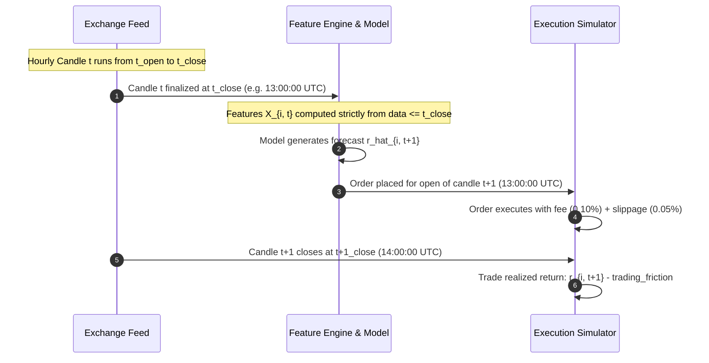

# Phase 2 Experiment Design: Leakage-Safe Multi-Asset Generalization

**Project:** Crypto Price and Trend Prediction AI  
**Author:** Senior AI Engineering & Quantitative Research Team  
**Date:** 2026-10-27  
**Status:** Approved for Implementation  
**Deliverable:** `reports/phase2_experiment_design.md`  

---

## 1. Research Question & Formal Hypotheses

The primary research objective of Phase 2 is to determine empirically whether multi-asset training provides a statistically and economically meaningful advantage over single-asset models in cryptocurrency price and return forecasting.

### 1.1 Hypotheses
1. **Hypothesis $H_1$ (Pooled Training Advantage):** A model trained on a pooled panel of multiple assets learns transferable cross-asset market dynamics, yielding lower out-of-sample prediction error (RMSE/MAE) and superior directional accuracy compared to models trained solely on individual assets.
2. **Hypothesis $H_2$ (Zero-Shot Cross-Asset Transferability):** A model trained on assets $\{A_1, A_2\}$ can generalize out-of-sample to an unseen asset $A_3$ (Leave-One-Asset-Out) with predictive skill greater than a naive random walk or zero-return baseline.
3. **Null Hypothesis $H_0$:** Due to asset-specific idiosyncrasies, market microstructure differences, and differing volatility regimes, pooling assets either degrades performance (negative transfer) or provides no statistically significant benefit over asset-specific models.

---

## 2. Target Definition, Horizon & Causal Timing

### 2.1 Formal Target Specification
We forecast the 1-period forward return:
$$r_{i, t+1} = \frac{C_{i, t+1} - C_{i, t}}{C_{i, t}}$$
where $C_{i, t}$ denotes the closing price of asset $i \in \{\text{BTC}, \text{ETH}, \text{SOL}\}$ for hourly candle $t$.

### 2.2 Execution & Information Timeline


- **Information Availability:** At time $t_{\text{close}}$, all bar statistics ($O_t, H_t, L_t, C_t, V_t$) and derived rolling metrics are fixed.
- **No Look-Ahead:** Features $X_{i, t}$ never reference prices or volumes at $s > t$. Target $r_{i, t+1}$ is strictly held out during feature generation.
- **Execution Friction:** Realistic trading costs are applied:
  $$\text{unit\_cost} = 0.0010 \text{ (taker fee)} + 0.0005 \text{ (slippage)} = 0.0015 \text{ per side}$$

---

## 3. Scale-Invariant Feature Representation

To pool distinct cryptocurrencies trading at vastly different price levels (BTC $\sim \$40,000$, ETH $\sim \$2,500$, SOL $\sim \$100$), all features must be scale-invariant.

The 46 features engineered by `FeatureEngineer` satisfy this criterion:
1. **Return Lags:** $\frac{C_t - C_{t-k}}{C_{t-k}}$ (dimensionless percentages).
2. **Normalized Volatilities:** Realized rolling standard deviation of percentage returns over windows $w \in \{6, 12, 24, 72, 168\}$.
3. **Bounded Oscillators:** RSI (0 to 100), Stochastic $\%K$ and $\%D$ (0 to 100), Williams $\%R$ (-100 to 0).
4. **Normalized Price Spreads:** $\frac{H_t - L_t}{C_t}$, $\frac{C_t - O_t}{H_t - L_t}$ (dimensionless ratios).
5. **Moving Average Distances:** $\frac{C_t - \text{EMA}_w(C)}{C_t}$.
6. **Candlestick Pattern Signals:** Binary indicators $\{0, 1\}$ or bounded confidences $[0, 1]$ (e.g. pinbar, engulfing, doji).
7. **Volume Z-Scores / Ratios:** $\frac{V_t}{\text{SMA}_w(V)}$ (unitless relative volume).

For Experiment B (Pooled Model), we also evaluate the addition of one-hot asset indicator flags (`is_BTC`, `is_ETH`, `is_SOL`) to allow the booster to partition asset-specific baseline behaviors if advantageous.

---

## 4. Chronological Splitting, Purging & Temporal Synchronization

### 4.1 Synchronized Time Horizons
The benchmark panel spans 1,500 hourly bars from `2024-01-01 00:00:00` to `2024-03-03 11:00:00 UTC` across BTC, ETH, and SOL.
- **Warmup Period:** The initial 168 bars (`2024-01-01 00:00` to `2024-01-08 00:00 UTC`) initialize the longest rolling indicators (168-hour / 7-day EMA and volatility).
- **Usable Timeline:** 1,331 synchronized bars (`2024-01-08 00:00` to `2024-03-03 11:00 UTC`).

### 4.2 Split Boundaries with Purging
```
Timeline: [----------- TRAIN (70%) -----------] [P] [--- VAL (15%) ---] [P] [--- TEST (15%) ---]
Indices:  0 .............................. 930   931 932 ......... 1130 1131 1132 ....... 1330
Bars:     931 bars                         1 bar 199 bars          1 bar 199 bars
```
- **Train Split:** Bars 0 to 930 (931 bars per asset; $2,793$ pooled rows).
- **Purge Gap 1:** Bar 931 dropped to ensure target $r_{t+1}$ of bar 930 does not overlap with features of bar 932.
- **Validation Split:** Bars 932 to 1130 (199 bars per asset; $597$ pooled rows). Used strictly for model tuning, threshold selection, and early stopping.
- **Purge Gap 2:** Bar 1131 dropped.
- **Test Split (Out-of-Sample):** Bars 1132 to 1330 (199 bars per asset; $597$ pooled rows). Reserved purely for final out-of-sample evaluation.

### 4.3 Preprocessing Isolation
- Any feature normalizers (e.g. `StandardScaler`) and target normalizers are fitted **strictly on the Train partition** of the training assets.
- Validation and Test sets are transformed using the fixed training parameters ($\mu_{\text{train}}, \sigma_{\text{train}}$).
- In Leave-One-Asset-Out experiments, the held-out asset's data is never seen by the scaler.

---

## 5. Experimental Protocols

### 5.1 Experiment A: Single-Asset Baseline Models
- For each asset $A \in \{\text{BTC}, \text{ETH}, \text{SOL}\}$:
  - Train model $M_A$ on $A$'s training partition ($931$ rows).
  - Tune/validate on $A$'s validation partition ($199$ rows).
  - Evaluate on $A$'s test partition ($199$ rows).

### 5.2 Experiment B: Pooled Multi-Asset Model
- Combine training partitions across all three assets into panel $D_{\text{train}} = D_{\text{train}}^{\text{BTC}} \cup D_{\text{train}}^{\text{ETH}} \cup D_{\text{train}}^{\text{SOL}}$ ($2,793$ rows).
- Train a single unified model $M_{\text{pooled}}$ on $D_{\text{train}}$.
- Evaluate $M_{\text{pooled}}$ on the individual test partitions of BTC, ETH, and SOL, as well as the pooled test set ($597$ rows).

### 5.3 Experiment C: Leave-One-Asset-Out (LOAO) Generalization
For each target asset $H \in \{\text{BTC}, \text{ETH}, \text{SOL}\}$:
1. Form training pool from the remaining two assets: $D_{\text{train}}^{-H} = \bigcup_{A \neq H} D_{\text{train}}^A$ ($1,862$ rows).
2. Train model $M_{-H}$ on $D_{\text{train}}^{-H}$.
3. Evaluate $M_{-H}$ directly on the test partition of the held-out asset $D_{\text{test}}^H$ ($199$ rows).
4. Compare $M_{-H}$ against:
   - Zero-Return Baseline on $H$
   - Single-Asset Model $M_H$ (trained on $H$)
   - Pooled Model $M_{\text{pooled}}$

---

## 6. Evaluation Metrics & Statistical Testing

### 6.1 Prediction Metrics (Regression & Direction)
- **Root Mean Squared Error (RMSE):** Measures forecast error magnitude.
- **Mean Absolute Error (MAE):** Robust linear error.
- **Out-of-Sample $R^2$:**
  $$R^2_{\text{OOS}} = 1 - \frac{\sum_{t} (r_t - \hat{r}_t)^2}{\sum_t (r_t - \bar{r}_{\text{train}})^2}$$
- **Directional Accuracy (DA):** Percentage of correctly predicted return signs:
  $$\text{DA} = \frac{1}{N} \sum_{t=1}^N \mathbf{1}_{\{\text{sign}(\hat{r}_t) == \text{sign}(r_t)\}} \quad (\text{for } \hat{r}_t \neq 0)$$
- **Information Coefficient (Rank IC):** Spearman rank correlation between predicted and realized returns across the cross-section.

### 6.2 Realistic Trading Simulation
Using `StrategyBacktester` with fees ($0.10\%$) and slippage ($0.05\%$):
- Gross Cumulative Return ($\%$)
- Total Transaction Costs ($\%$)
- Net Cumulative Return ($\%$)
- Annualized Sharpe Ratio
- Maximum Drawdown ($\%$)
- Total Trade Count and Turnover

---

## 7. Model Families Evaluated
To eliminate algorithm bias, all three experiments (Single, Pooled, LOAO) will be evaluated across multiple distinct model families:
1. **Baselines:** Zero-Return Baseline, Mean-Return Baseline
2. **Linear / Regularized:** Ridge Regression ($\alpha=1.0$)
3. **Gradient Boosted Trees:**
   - **Ridge Regressor**
   - **Random Forest** ($n=100, \text{depth}=5$)
   - **XGBoost** ($n=150, \text{lr}=0.03, \text{depth}=4$)
   - **LightGBM** ($n=150, \text{lr}=0.03, \text{depth}=4, \text{leaves}=15$)
   - **CatBoost** ($n=150, \text{lr}=0.03, \text{depth}=4$)
