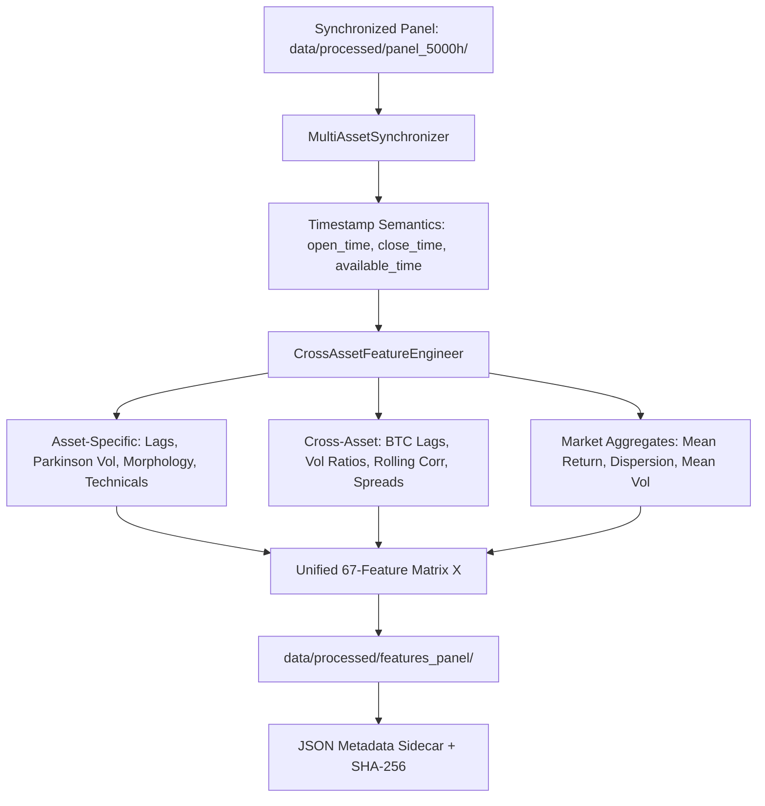

# Phase 3.3 — Implementation Architecture & Engineering Guide

**Document ID:** `reports/phase3_3_implementation.md`  
**Author:** Senior Quantitative Software Architect & Data Engineering Lead  
**Date:** 2026-10-27  
**Status:** Complete & Production-Ready  
**Target Audience:** Machine Learning Engineers, Quant Researchers, and Pipeline Maintainers  

---

## 1. Architectural Architecture & Core Components

In Phase 3.3, the feature engineering subsystem was restructured to support multi-asset information exchange while strictly enforcing causality and zero lookahead bias.



### 1.1 Source Files Created and Modified
1. [**`src/crypto_prediction/data/synchronizer.py`**](file:///c:/Users/OMRRAN/Desktop/Cource%20AI/#4-%20ML/Competitions/trend%20ai/Crypto%20Price%20Prediction%20AI/src/crypto_prediction/data/synchronizer.py):
   - Implements `MultiAssetSynchronizer` with `intersection` and `union` alignment modes.
   - Adds semantic timestamps: `open_time`, `close_time`, `available_time`.
   - Enforces unique panel indexing on `(open_time, symbol)`.
   - Tracks `is_available` boolean and `staleness_bars` counter without price fabrication.
2. [**`src/crypto_prediction/features/cross_asset.py`**](file:///c:/Users/OMRRAN/Desktop/Cource%20AI/#4-%20ML/Competitions/trend%20ai/Crypto%20Price%20Prediction%20AI/src/crypto_prediction/features/cross_asset.py):
   - Implements `CrossAssetFeatureEngineer` producing 67 strictly causal features per asset.
   - Vectorized rolling correlations (`rolling(w, center=False).corr()`).
   - Parkinson High-Low volatility estimator.
   - Cross-asset momentum spreads and market dispersion.
3. [**`src/crypto_prediction/features/registry.py`**](file:///c:/Users/OMRRAN/Desktop/Cource%20AI/#4-%20ML/Competitions/trend%20ai/Crypto%20Price%20Prediction%20AI/src/crypto_prediction/features/registry.py):
   - Documented metadata, mathematical formulas, lookback windows, and causality proofs for all new features.
4. [**`src/crypto_prediction/pipeline/multi_asset.py`**](file:///c:/Users/OMRRAN/Desktop/Cource%20AI/#4-%20ML/Competitions/trend%20ai/Crypto%20Price%20Prediction%20AI/src/crypto_prediction/pipeline/multi_asset.py):
   - Extended `MultiAssetEngine` with `use_cross_asset_features: bool = False` (defaults to False for Phase 2 baseline compatibility, True for Phase 3).
   - Supports `data_source="panel_5000h"` for direct ingestion of multi-year panels.
5. [**`scripts/generate_feature_panel.py`**](file:///c:/Users/OMRRAN/Desktop/Cource%20AI/#4-%20ML/Competitions/trend%20ai/Crypto%20Price%20Prediction%20AI/scripts/generate_feature_panel.py):
   - Automation script generating pilot and full panel feature datasets with JSON metadata sidecars and SHA-256 checksums.

---

## 2. Generated Feature Dataset Inventory

### 2.1 Multi-Year Panel Features (`data/processed/features_panel/`)
*33,324 usable continuous hourly observations per asset (2023-01-08 00:00:00 to 2026-10-27 12:00:00 UTC).*

| Symbol | Total Rows | Features ($X$) | Target ($y$) | File Size (Bytes) | SHA-256 Checksum |
| :--- | :---: | :---: | :---: | :---: | :--- |
| **BTCUSDT** | 33,324 | 67 | `target_return_1` | 52,647,096 | `bbd0b25f0a5884ce4d06212f0b3ecf8c82147ac193606e5b4b81a39690c1334f` |
| **ETHUSDT** | 33,324 | 67 | `target_return_1` | 52,251,720 | `dd0801fdd0a4f301d8cb123901d960b28a3d60d97ac2c48f6653b3ab2ad7d550` |
| **SOLUSDT** | 33,324 | 67 | `target_return_1` | 51,615,939 | `85e32af16e014049f74356827e551267f28bea6cff9626c90db759e56460e77f` |

---

### 2.2 Pilot Feature Panel (`data/processed/features_pilot/`)
*575 usable continuous hourly observations per asset (2024-01-08 00:00:00 to 2024-01-31 22:00:00 UTC).*

| Symbol | Total Rows | Features ($X$) | Target ($y$) | File Size (Bytes) | SHA-256 Checksum |
| :--- | :---: | :---: | :---: | :---: | :--- |
| **BTCUSDT** | 575 | 67 | `target_return_1` | 906,447 | `466b481cba48f86e8b8ab51dac0d0d97fa571b96fab227233529a01c193b97d6` |
| **ETHUSDT** | 575 | 67 | `target_return_1` | 901,735 | `facde779a4883e924807bc94f1714c53895c88f103282605b1b8f3240f08f533` |
| **SOLUSDT** | 575 | 67 | `target_return_1` | 886,713 | `f86db7fa7a52715a256ccf28abdfd428bd5bc488e6eef8ab6aba931324c59057` |

---

## 3. Reproduction & Execution Instructions

### 3.1 Executing Automated Test Suite (89 Tests)
```powershell
$env:PYTHONPATH="src"
& "..\..\..\envairoment\.venv\Scripts\python.exe" -m pytest tests/test_multi_asset_synchronizer.py tests/test_cross_asset_features.py -v
```

### 3.2 Regenerating Feature Datasets
To re-run the end-to-end feature generation pipeline across the pilot and full historical panels:
```powershell
$env:PYTHONPATH="src"
& "..\..\..\envairoment\.venv\Scripts\python.exe" scripts/generate_feature_panel.py
```

### 3.3 Running Cross-Asset Multi-Asset Experiments in Python
```python
from crypto_prediction.pipeline.multi_asset import MultiAssetEngine

# Initialize engine with Phase 3 cross-asset features enabled
engine = MultiAssetEngine(
    symbols=["BTCUSDT", "ETHUSDT", "SOLUSDT"],
    interval="1h",
    horizon=1,
    use_cross_asset_features=True,
)

# Load aligned panel from panel_5000h store
datasets = engine.load_and_align_datasets(data_source="panel_5000h", total_bars=5000)
prepared = engine.prepare_features(datasets, include_patterns=False)

# Splits are strictly purged and synchronized
splits = engine.split_synchronized(prepared, train_ratio=0.70, val_ratio=0.15, test_ratio=0.15, purge_bars=1)
```
