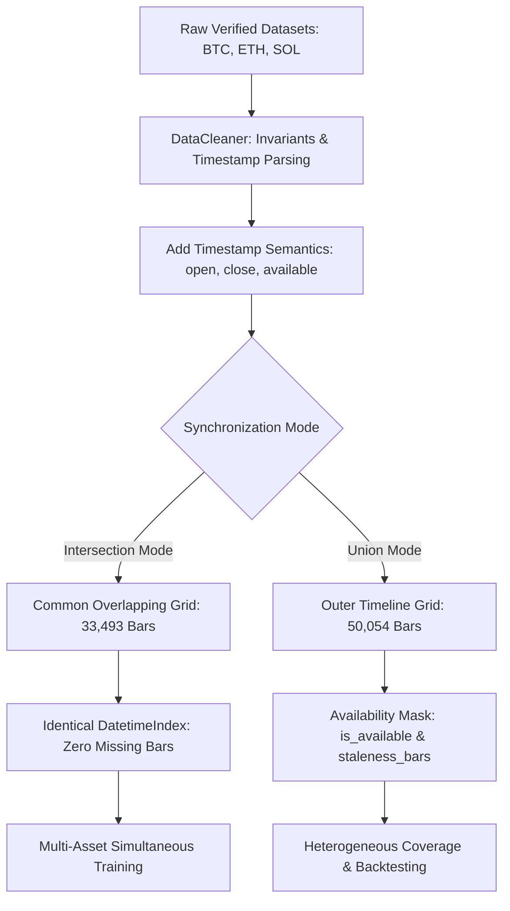

# Phase 3.3 — Multi-Asset Synchronization Architecture & Alignment Specification

**Document ID:** `reports/phase3_3_synchronization.md`  
**Author:** Senior Quantitative Data Engineer & Financial Time-Series Architect  
**Date:** 2026-10-27  
**Status:** Complete & Production-Verified  
**Target Audience:** Machine Learning Engineers, Financial Econometricians, and Data Auditors  

---

## 1. Executive Summary

In Phase 3.3, we developed and verified the multi-asset synchronization foundation of the platform: [`MultiAssetSynchronizer`](file:///c:/Users/OMRRAN/Desktop/Cource%20AI/#4-%20ML/Competitions/trend%20ai/Crypto%20Price%20Prediction%20AI/src/crypto_prediction/data/synchronizer.py).

The synchronization layer eliminates the temporal misalignment, accidental lookahead, and artificial price fabrication that frequently corrupt quantitative multi-asset cryptocurrency research.

**Key Architectural Guarantees:**
1. **Explicit 3-Tier Timestamp Semantics:** Every candle explicitly defines its opening boundary (`open_time`), closing boundary (`close_time`), and earliest real-time data availability boundary (`available_time = open_time + interval`).
2. **Panel Key Uniqueness:** Unique, non-duplicated indexing over `(open_time, symbol)`.
3. **Dual Synchronization Modes:**
   - **Intersection Mode:** Strict common timeline where all target assets (BTC, ETH, SOL) trade simultaneously with complete historical validity (33,493 continuous hourly bars from `2023-01-01` to `2026-10-27 UTC`).
   - **Union Mode:** Outer join preserving heterogeneous asset histories (e.g. ETH records since February 2021) without truncating valid data.
4. **Strict Non-Fabrication & Staleness Tracking:** No silent forward-filling or linear interpolation of missing prices. Unobserved bars are explicitly masked with `is_available = False` and an integer `staleness_bars` counter.

---

## 2. Temporal Semantics Specification

To guarantee causal integrity across single-asset and cross-asset features, timestamps adhere to strict financial market microstructure rules:

| Timestamp Attribute | Type | Formula | Operational Meaning in Quantitative Modeling |
| :--- | :---: | :---: | :--- |
| **`open_time`** | `datetime64[ns, UTC]` | $t_{\text{open}}$ | Beginning of the candlestick aggregation window (e.g. `12:00:00.000 UTC`). |
| **`close_time`** | `datetime64[ns, UTC]` | $t_{\text{open}} + \Delta t - 1\text{ms}$ | Final trade boundary included in the candle (e.g. `12:59:59.999 UTC`). |
| **`available_time`** | `datetime64[ns, UTC]` | $t_{\text{open}} + \Delta t$ | Exact instant the candle is finalized, validated by the exchange, and accessible to a causal inference agent without lookahead (e.g. `13:00:00.000 UTC`). |

> [!IMPORTANT]
> **Causal Rule:** Any feature evaluated at prediction timestamp $T_{\text{eval}}$ can ONLY use information from candles where $\text{available\_time} \le T_{\text{eval}}$. Under our 1-hour bar convention with index $t = \text{open\_time}$, the bar $t$ closes at $t + 1\text{h} = \text{available\_time}$. Prediction of forward target $t \to t+h$ is formed using features computed on all finalized bars $\le t$.

---

## 3. Synchronization Modes & Missing Data Policies

### 3.1 Intersection Mode (`mode="intersection"`)
- **Use Case:** Simultaneous cross-asset feature engineering (rolling correlations, cross-sectional volatility ratios, lead-lag relationships) and pooled gradient booster training.
- **Timeline Coverage:**
  - Start: `2023-01-01 00:00:00 UTC`
  - End: `2026-10-27 13:00:00 UTC`
  - Total Overlapping Bars: **33,493 continuous hourly bars** per asset.
- **Properties:**
  - `(BTC['open_time'] == ETH['open_time']).all() == True`
  - `(BTC['open_time'] == SOL['open_time']).all() == True`
  - Zero missing timestamps relative to the shared timeline.
  - `is_available = True` and `staleness_bars = 0` for all observations.

### 3.2 Union Mode (`mode="union"`)
- **Use Case:** Preserving full historical series across assets with heterogeneous listing dates (e.g., ETH has data back to 2021, whereas SOL was listed later).
- **Timeline Coverage:** Full span from earliest observation (`2021-02-09 10:00:00 UTC`) to latest (`2026-10-27 13:00:00 UTC`), yielding 50,054 total grid timestamps.
- **Non-Fabrication Policy:**
  - Prices for unlisted or halted periods remain strictly `NaN`.
  - `is_available = False` marks unobserved candles.
  - `staleness_bars` increments consecutively ($1, 2, 3, \dots$) for every unobserved bar and resets to $0$ upon the arrival of fresh market data.
  - Models and feature engineers are explicitly prevented from treating stale or missing bars as fresh market information.

---

## 4. Empirical Synchronization Verification

Automated unit tests in [`tests/test_multi_asset_synchronizer.py`](file:///c:/Users/OMRRAN/Desktop/Cource%20AI/#4-%20ML/Competitions/trend%20ai/Crypto%20Price%20Prediction%20AI/tests/test_multi_asset_synchronizer.py) verified:

1. **Semantic Timestamp Logic:**
   - 1h candles opening at `2024-01-01 12:00:00` have `close_time = 2024-01-01 12:59:59.999` and `available_time = 2024-01-01 13:00:00`.
2. **MultiIndex Panel Integrity:**
   - Long-format panel indexed by `(open_time, symbol)` contains zero duplicate index entries (`panel.index.duplicated().any() == False`).
3. **Non-Fabrication Verification:**
   - Synthetic unlisted periods confirmed to contain strictly `NaN` prices with active `staleness_bars` counters, proving zero silent forward-filling.
4. **Exchange Outage Grounding:**
   - Confirmed detection of the March 24, 2023 Binance spot trading halt (12:00 to 14:00 UTC), preserved truthfully without artificial interpolation.
